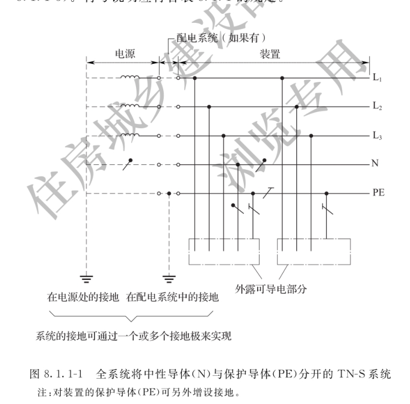
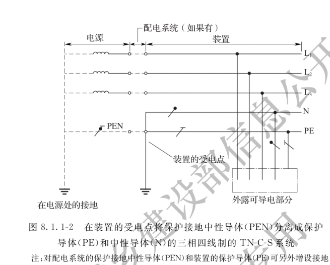
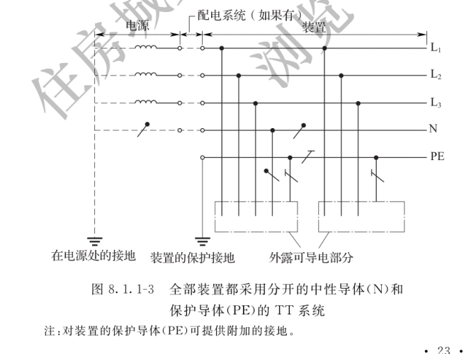

# 1 总 则

### 1.0.1 为在建设工程施工现场供用电中贯彻执行"安全第一、预防为主、综合治理"的方针，确保在施工现场供用电过程中的人身安全和设备安全，并使施工现场供用电设施的设计、施工、运行、维护及拆除做到安全可靠，确保质量，经济合理，制定本规范。

### 1.0.2 本规范适用于一般工业与民用建设工程，施工现场电压在10kV及以下的供用电设施的设计、施工、运行、维护及拆除，不适用于水下、井下和矿井等工程。

### 1.0.3 施工现场供用电应符合下列原则：

            1 对危及施工现场人员的电击危险应进行防护；
            2 施工现场供用电设施和电动机具应符合国家现行有关标准的规定，线路绝缘应良好。

### 1.0.4 建设工程施工现场供用电设施的设计、施工、运行、维护及拆除，除应符合本规范的规定外，尚应符合国家现行有关标准的规定。

# 2 术 语

### 2.0.1 电击 electric shock

电流通过人体或动物躯体而引起的生理效应。

### 2.0.2 直接接触 direct contact

人或动物与带电部分的接触。

### 2.0.3 间接接触 indirect contact

人或动物与故障情况下变为带电的外露导电部分的接触。

### 2.0.4 预装箱式变电站 prefabricated cubical substation

由高压开关设备、电力变压器、低压开关设备、电能计量设备、无功补偿设备、辅助设备和联结件等元件组成的成套配电设备，这些元件在工厂内被预先组装在一个或几个箱壳内，用来从高压系统向低压系统输送电能。

### 2.0.5 防护等级 degree of protection

按标准规定的检验方法，外壳对接近危险部件、防止固体异物进入或水进入所提供的保护程度。

### 2.0.6 IP代码 IP code

表明外壳对人接近危险部位、防止固体异物进入或水进入的防护等级以及与这些防护有关的附加信息的代码系统。

### 2.0.7 中性导体(N) neutral conductor

电气上与中性点连接并能用于配电的导体。

### 2.0.8 保护导体(PE) protective conductor

为了安全目的，用于电击防护所设置的导体。

### 2.0.9 保护接地中性导体(PEN) PEN conductor

兼有保护导体(PE)和中性导体(N)功能的导体。

### 2.0.10 外电线路 external line

施工现场供用电线路以外的电力线路。

### 2.0.11 外露可导电部分 exposed conductive part

设备上能触及的可导电部分，它在正常状况下不带电，但在基本绝缘损坏时会带电。

### 2.0.12 接地装置 earth-termination system

接地体和接地线的总和。

### 2.0.13 保护接地 protective earthing

为了电气安全，将系统、装置或设备的一点或多点接地。

### 2.0.14 接地电阻 earth resistance

接地体或自然接地体的对地电阻和接地线电阻的总和。接地电阻的数值等于接地装置对地电压与通过接地体流入地中电流的比值。

### 2.0.15 接地极 earth electrode

埋入土壤或特定的导电介质中、与大地有电接触的可导电部分。

### 2.0.16 自然接地体 natural earthing electrode

可作为接地用的直接与大地接触的各种金属构件、金属井管、钢筋混凝土建筑的基础、金属管道和设备等。

### 2.0.17 安全隔离变压器 safety isolation transformer

设计成提供SELV(安全特低电压)的隔离变压器。

### 2.0.18 特低电压 extra-low voltage

不超过现行国家标准《建筑物电气装置的电压区段》GB/T 18379(IEC 60449)规定的有关Ⅰ类电压限值的电压。

### 2.0.19 安全特低电压系统 SELV system

由隔离变压器或发电机、蓄电池等隔离电源供电的交流或直流特低电压回路。其回路导体不接地，电气设备外壳不有意连接保护导体(PE)接地，但可与地接触。

### 2.0.20 特殊环境 special environment

本规范中将高原，易燃、易爆，腐蚀性和潮湿环境列为特殊环境。

### 2.0.21 高原 plateau

按照地理学概念，海拔超过1000m的地域。

### 2.0.22 腐蚀环境 corrosive environment

由于化学腐蚀性物质和大气中水分的存在而使得设备或材料产生破坏或变质的地点或处所，称为化学腐蚀环境，可简称为腐蚀环境。

### 2.0.23 潮湿环境 damp environment

本规范仅指相对湿度大于95%的空气环境、场地积水环境、泥泞的环境。

# 3 供用电设施的设计、施工、验收

## 3.1 供用电设施的设计

### 3.1.1 供用电设计应按照工程规模、场地特点、负荷性质、用电容量、地区供用电条件，合理确定设计方案。

### 3.1.2 供用电设计应经审核、批准后实施。

### 3.1.3 供用电设计至少应包括下列内容：

            1 设计说明；
            2 施工现场用电容量统计；
            3 负荷计算；
            4 变压器选择；
            5 配电线路；
            6 配电装置；
            7 接地装置及防雷装置；
            8 供用电系统图、平面布置图。

## 3.2 供用电设施的施工

### 3.2.1 供用电施工方案或施工组织设计应经审核、批准后实施。

### 3.2.2 供用电施工方案或施工组织设计应包括下列内容：

            1 工程概况；
            2 编制依据；
            3 供用电施工管理组织机构；
            4 配电装置安装、防雷接地装置安装、线路敷设等施工内容的技术要求；
            5 安全用电及防火措施。

### 3.2.3 供用电设施的施工应按照已批准的供用电施工方案进行施工。

## 3.3 供用电设施的验收

### 3.3.1 供用电工程施工完毕，电气设备应按现行国家标准《电气装置安装工程 电气设备交接试验标准》GB 50150的规定试验合格。

### 3.3.2 供用电工程施工完毕后，应有完整的平面布置图、系统图、隐蔽工程记录、试验记录，经验收合格后方可投入使用。
# 4 发电设施

### 4.0.1 施工现场发电设施的选址应根据负荷位置、交通运输、线路布置、污染源频率风向、周边环境等因素综合考虑。发电设施不应设在地势低洼和可能积水的场所。

### 4.0.2 发电机组的安装和使用应符合下列规定：

            1 供电系统接地型式和接地电阻应与施工现场原有供用电系统保持一致。
            2 发电机组应设置短路保护、过负荷保护。
            3 当两台或两台以上发电机组并列运行时，应采取限制中性点环流的措施。
            4 发电机组周围不得有明火，不得存放易燃、易爆物。发电场所应设置可在带电场所使用的消防设施，并应标识清晰、醒目，便于取用。

### 4.0.3 移动式发电机的使用应符合下列规定：

            1 发电机停放的地点应平坦，发电机底部距地面不应小于0.3m；
            2 发电机金属外壳和拖车应有可靠的接地措施；
            3 发电机应固定牢固；
            4 发电机应随车配备消防灭火器材；
            5 发电机上部应设防雨棚，防雨棚应牢固、可靠。

### 4.0.4 发电机组电源必须与其他电源互相闭锁，严禁并列运行。

# 5 变电设施

### 5.0.1 变电所的设计应符合现行国家标准《10kV及以下变电所设计规范》GB 50053的有关规定。

### 5.0.2 变电所位置的选择应符合下列规定：

            1 应方便日常巡检和维护；
            2 不应设在易受施工干扰、地势低洼易积水的场所。

### 5.0.3 变电所对于其他专业的要求应符合下列规定：

            1 面积与高度应满足变配电装置的维护与操作所需的安全距离；
            2 变配电室内应配置适用于电气火灾的灭火器材；
            3 变配电室应设置应急照明；
            4 变电所外醒目位置应标识维护运行机构、人员、联系方式等信息；
            5 变电所应设置排水设施。

### 5.0.4 变电所配电装置的选择和布置应符合下列规定：

            1 当采用箱式变电站时，其外壳防护等级不应低于本规范附录A外壳防护等级(IP代码)IP23D，且应满足施工现场环境状况要求；
            2 户外安装的箱式变电站，其底部距地面的高度不应小于0.5m；
            3 露天或半露天布置的变压器应设置不低于1.7m高的固定围栏或围墙，并应在明显位置悬挂警示标识；
            4 变压器或箱式变电站外廓与围栏或围墙周围应留有不小于1m的巡视或检修通道。
            1 油浸电力变压器的现场安装及验收应符合现行国家标准《电气装置安装工程 电力变压器、油浸电抗器、互感器施工及验收规范》GB 50148的有关规定。
            2 箱式变电站外壳应有可靠的保护接地。装有成套仪表和继电器的屏柜、箱门，应与壳体进行可靠电气连接。
            3 户外箱式变电站的进出线应采用电缆，所有的进出线电缆孔应封堵。
            4 箱式变电站基础所留设通风孔应能防止小动物进入。

### 5.0.6 变电所变配电装置的投运应符合下列规定：

            1 变电所变配电装置安装完毕或检修后，投入运行前应对其内部的电气设备进行检查和电气试验，合格后方可投入运行。
            2 变压器第一次投运时，应进行5次空载全电压冲击合闸，并应无异常情况；第一次受电后持续时间不应少于10min。

# 6 配电设施

## 6.1 一般规定

### 6.1.1 低压配电系统宜采用三级配电，宜设置总配电箱、分配电箱、末级配电箱。

### 6.1.2 低压配电系统不宜采用链式配电。当部分用电设备距离供电点较远，而彼此相距很近、容量小的次要用电设备，可采用链式配电，但每一回路环链设备不宜超过5台，其总容量不宜超过10kW。

### 6.1.3 消防等重要负荷应由总配电箱专用回路直接供电，并不得接入过负荷保护和剩余电流保护器。

### 6.1.4 消防泵、施工升降机、塔式起重机、混凝土输送泵等大型设备应设专用配电箱。

### 6.1.5 低压配电系统的三相负荷宜保持平衡，最大相负荷不宜超过三相负荷平均值的115%，最小相负荷不宜小于三相负荷平均值的85%。

### 6.1.6 用电设备端的电压偏差允许值宜符合下列规定：

            1 一般照明：宜为+5%/-10额定电压；
            2 一般用途电机：宜为±5%额定电压；
            3 其他用电设备：当无特殊规定时宜为±5%额定电压。

## 6.2 配电室

### 6.2.1 配电室的选址及对其他专业的要求应符合本规范第5.0.1条、第5.0.2条的有关规定。
### 6.2.2 配电室配电装置的布置应符合下列规定：

            1 成排布置的配电柜，其柜前、柜后的操作和维护通道净宽不宜小于表6.2.2的规定；

表6.2.2 成排布置配电柜的柜前、柜后的操作和维护通道净宽(m)

| 布置方式 | 单排布置 | 双排对面布置 | 双排背对背布置 |
|:---:|:---:|:---:|:---:|
|  | 柜前 | 柜后 | 柜前 | 柜后 | 柜前 | 柜后 |
| 配电柜 | 1.5 | 1.0 | 2.0 | 1.0 | 1.5 | 1.5 |

            2 当成排布置的配电柜长度大于6m时，柜后的通道应设置两个出口；
            3 配电装置的上端距棚顶距离不宜小于0.5m；
            4 配电装置的正上方不应安装照明灯具。

### 6.2.3 配电柜电源进线回路应装设具有电源隔离、短路保护和过负荷保护功能的电器。

### 6.2.4 配电柜的安装应符合下列规定：

      1 配电柜应安装在高于地面的型钢或混凝土基础上，且应平正、牢固。
      2 配电柜的金属框架及基础型钢应可靠接地。门和框架的接地端子间应采用软铜线进行跨接，配电柜门和框架间跨接接地线的最小截面积应符合下列规定。
            额定工作电流I_e≤25A，接地线的最小截面积2.5mm^2；
            额定工作电流25＜I_e≤32A，接地线的最小截面积4mm^2；
            额定工作电流32＜I_e≤63A，接地线的最小截面积6mm^2；
            额定工作电流63＜I_eA，接地线的最小截面积10mm^2。
            注：I_e为配电柜(箱)内主断路器的额定电流。
      3 配电柜内应分别设置中性导体(N)和保护导体(PE)汇流排，并有标识。保护导体(PE)汇流排上的端子数量不应少于进线和出线回路的数量。
      4 导线压接应可靠，且防松垫圈等零件应齐全，不伤线芯，不断股。

## 6.3 配电箱

### 6.3.1 总配电箱以下可设若干分配电箱；分配电箱以下可设若干末级配电箱。分配电箱以下可根据需要，再设分配电箱。总配电箱应设在靠近电源的区域，分配电箱应设在用电设备或负荷相对集中的区域，分配电箱与末级配电箱的距离不宜超过30m。

### 6.3.2 动力配电箱与照明配电箱宜分别设置。当合并设置为同一配电箱时，动力和照明应分路供电；动力末级配电箱与照明末级配电箱应分别设置。

### 6.3.3 用电设备或插座的电源宜引自末级配电箱，当一个末级配电箱直接控制多台用电设备或插座时，每台用电设备或插座应有各自独立的保护电器。

### 6.3.4 当分配电箱直接控制用电设备或插座时，每台用电设备或插座应有各自独立的保护电器。

### 6.3.5 户外安装的配电箱应使用户外型，其防护等级不应低于本规范附录A外壳防护等级(IP代码)IP44，门内操作面的防护等级不应低于IP21。

### 6.3.6 固定式配电箱的中心与地面的垂直距离宜为1.4m～1.6m，安装应平正、牢固。户外落地安装的配电箱、柜，其底部离地面不应小于0.2m。

### 6.3.7 总配电箱、分配电箱内应分别设置中性导体(N)、保护导体(PE)汇流排，并有标识；保护导体(PE)汇流排上的端子数量不应少于进线和出线回路的数量。

### 6.3.8 配电箱内断路器相间绝缘隔板应配置齐全；防电击护板应阻燃且安装牢固。

### 6.3.9 配电箱内连接线绝缘层的标识色应符合下列规定：

            1 相导体L_1、L_2、L_3应依次为黄色、绿色、红色；
            2 中性导体(N)应为淡蓝色；
            3 保护导体(PE)应为绿-黄双色；
            4 上述标识色不应混用。

### 6.3.10 配电箱内的连接线应采用铜排或铜芯绝缘导线，当采用铜排时应有防护措施；连接导线不应有接头、线芯损伤及断股。

### 6.3.11 配电箱内的导线与电器元件的连接应牢固、可靠。导线端子规格与芯线截面适配，接线端子应完整，不应减小截面积。

### 6.3.12 配电箱的金属箱体、金属电器安装板以及电器正常不带电的金属底座、外壳等应通过保护导体(PE)汇流排可靠接地。金属箱门与金属箱体间的跨接接地线应符合本规范表6.2.4的有关规定。

### 6.3.13 配电箱电缆的进线口和出线口应设在箱体的底面，当采用工业连接器时可在箱体侧面设置。工业连接器配套的插头插座、电缆耦合器、器具耦合器等应符合现行国家标准《工业用插头插座和耦合器 第1部分：通用要求》GB/T 11918及《工业用插头插座和耦合器 第2部分：带插销和插套的电器附件的尺寸互换性要求》GB/T 11919的有关规定。

### 6.3.14 当分配电箱直接供电给末级配电箱时，可采用分配电箱设置插座方式供电，并应采用工业用插座，且每个插座应有各自独立的保护电器。

### 6.3.15 移动式配电箱的进线和出线应采用橡套软电缆。

### 6.3.16 配电箱的进线和出线不应承受外力，与金属尖锐断口接触时应有保护措施。

### 6.3.17 配电箱应按下列顺序操作：

            1 送电操作顺序为：总配电箱→分配电箱→末级配电箱；
            2 停电操作顺序为：末级配电箱→分配电箱→总配电箱。

### 6.3.18 配电箱应有名称、编号、系统图及分路标记。

## 6.4 开关电器的选择

### 6.4.1 配电箱内的电器应完好，不应使用破损及不合格的电器。

### 6.4.2 总配电箱、分配电箱的电器应具备正常接通与分断电路，以及短路、过负荷、接地故障保护功能。电器设置应符合下列规定：

            1 总配电箱、分配电箱进线应设置隔离开关、总断路器，当采用带隔离功能的断路器时，可不设置隔离开关。各分支回路应设置具有短路、过负荷、接地故障保护功能的电器。
            2 总断路器的额定值应与分路断路器的额定值相匹配。

### 6.4.3 总配电箱宜装设电压表、总电流表、电度表。

### 6.4.4 末级配电箱进线应设置总断路器，各分支回路应设置具有短路、过负荷、剩余电流动作保护功能的电器。

### 6.4.5 末级配电箱中各种开关电器的额定值和动作整定值应与其控制用电设备的额定值和特性相适应。

### 6.4.6 剩余电流保护器的选择、安装和运行应符合现行国家标准《剩余电流动作保护电器的一般要求》GB/Z 6829和《剩余电流动作保护装置安装和运行》GB 13955的有关规定。

### 6.4.7 当配电系统设置多级剩余电流动作保护时，每两级之间应有保护性配合，并应符合下列规定：

            1 末级配电箱中的剩余电流保护器的额定动作电流不应大于30mA，分断时间不应大于0.1s；
            2 当分配电箱中装设剩余电流保护器时，其额定动作电流不应小于末级配电箱剩余电流保护值的3倍，分断时间不应大于0.3s；
            3 当总配电箱中装设剩余电流保护器时，其额定动作电流不应小于分配电箱中剩余电流保护值的3倍，分断时间不应大于0.5s。

### 6.4.8 剩余电流保护器应用专用仪器检测其特性，且每月不应少于1次，发现问题应及时修理或更换。

### 6.4.9 剩余电流保护器每天使用前应启动试验按钮试跳一次，试跳不正常时不得继续使用。
# 7 配电线路

## 7.1 一般规定

### 7.1.1 施工现场配电线路路径选择应符合下列规定：

            1 应结合施工现场规划及布局，在满足安全要求的条件下，方便线路敷设、接引及维护；
            2 应避开过热、腐蚀以及储存易燃、易爆物的仓库等影响线路安全运行的区域；
            3 宜避开易遭受机械性外力的交通、吊装、挖掘作业频繁场所，以及河道、低洼、易受雨水冲刷的地段；
            4 不应跨越在建工程、脚手架、临时建筑物。

### 7.1.2 配电线路的敷设方式应符合下列规定：

            1 应根据施工现场环境特点，以满足线路安全运行、便于维护和拆除的原则来选择，敷设方式应能够避免受到机械性损伤或其他损伤；
            2 供用电电缆可采用架空、直埋、沿支架等方式进行敷设；
            3 不应敷设在树木上或直接绑挂在金属构架和金属脚手架上；
            4 不应接触潮湿地面或接近热源。

### 7.1.3 电缆选型应符合下列规定：

            1 应根据敷设方式、施工现场环境条件、用电设备负荷功率及距离等因素进行选择；
            2 低压配电系统的接地型式采用TN-S系统时，单根电缆应包含全部工作芯线和用作中性导体(N)或保护导体(PE)的芯线；
            3 低压配电系统的接地型式采用TT系统时，单根电缆应包含全部工作芯线和用作中性导体(N)的芯线。

### 7.1.4 低压配电线路截面的选择和保护应符合现行国家标准《低压配电设计规范》GB 50054的有关规定。

## 7.2 架空线路

### 7.2.1 架空线路采用的器材应符合下列规定：

            1 施工现场架空线路宜采用绝缘导线，架空绝缘导线应符合现行国家标准《额定电压1kV及以下架空绝缘电缆》GB/T 12527、《额定电压10kV架空绝缘电缆》GB/T 14049的有关规定；
            2 架空线路宜采用钢筋混凝土杆，钢筋混凝土杆不得有露筋、掉块等明显缺陷。

### 7.2.2 电杆埋设应符合下列规定：

            1 当电杆埋设在土质松软、流沙、地下水位较高的地带时，应采取加固杆基措施，遇有水流冲刷地带宜加围桩或围台；
            2 电杆组立后，回填土时应将土块打碎，每回填500mm应夯实一次，水坑回填前，应将坑内积水淘净；回填土后的电杆基坑应有防沉土台，培土高度应超出地面300mm。

### 7.2.3 施工现场架空线路的档距不宜大于40m，空旷区域可根据现场情况适当加大档距，但最大不应大于50m。

### 7.2.4 拉线的设置应符合下列规定：

            1 拉线应采用镀锌钢绞线，最小规格不应小于35mm²；
            2 拉线坑的深度不应小于1.2m，拉线坑的拉线侧应有斜坡；
            3 拉线应根据电杆的受力情况装设，拉线与电杆的夹角不宜小于45°，当受到地形限制时不得小于30°；
            4 拉线从导线之间穿过时应装设拉线绝缘子，在拉线断开时，绝缘子对地距离不得小于2.5m。

### 7.2.5 架空线路导线相序排列应符合下列规定：

            1 1kV～10kV线路：面向负荷从左侧起，导线排列相序应为L_1、L_2、L_3。
            2 1kV以下线路：面向负荷从左侧起，导线排列相序应为
L_1、N、L_2、L_3、PE。
            3 电杆上的中性导体(N)应靠近电杆。若导线垂直排列时，中性导体(N)应在下方。中性导体(N)的位置不应高于同一回路的相导体。在同一地区内，中性导体(N)的排列应统一。

### 7.2.6 施工现场供用电架空线路与道路等设施的最小距离应符合下列规定，否则应采取防护措施。

1.施工现场供用电架空线路的线路电压等级1kV及以下时，沿道路边敷设时距离道路路边沿最小水平距离为0.5m，跨越道路时距路面最小垂直距离为6.0m；10kV及以下时，沿道路边敷设时距离道路路边沿最小水平距离为1.0m，跨越道路时距路面最小垂直距离为7.0m；
2.施工现场供用电架空线路的线路电压等级1kV及以下时，与在建工程（包含脚手架工程）的最小水平距离为7.0m；10kV及以下时，与在建工程的最小水平距离为8.0m；
3.施工现场供用电架空线路的线路电压等级1kV及以下时，与临时建(构)筑物最小水平距离为1.0m；10kV及以下时，与临时建(构)筑物最小水平距离为2.0m；
4.施工现场供用电架空线路的线路电压等级1kV及以下时，与10kV及以下外电电力线路的最小垂直距离为2.0m、最小水平距离3.0m；与220kV及以下外电电力线路的最小垂直距离为4.0m、最小水平距离为7.0m；与5000kV及以下外电电力线路的最小垂直距离为6.0m、最小水平距离为13.0m；

### 7.2.7 架空线路穿越道路处应在醒目位置设置最大允许通过高度警示标识。

### 7.2.8 架空线路在跨越道路、河流、电力线路档距内不应有接头。

## 7.3 直埋线路

### 7.3.1 直埋线路宜采用有外护层的铠装电缆，芯线绝缘层标识应符合本规范第6.3.9条规定。

### 7.3.2 直埋敷设的电缆线路应符合下列规定：

      1 在地下管网较多、有较频繁开挖的地段不宜直埋。
      2 直埋电缆应沿道路或建筑物边缘埋设，并宜沿直线敷设，直线段每隔20m处、转弯处和中间接头处应设电缆走向标识桩。
      3 电缆直埋时，其表面距地面的距离不宜小于0.7m；电缆上、下、左、右侧应铺以软土或砂土，其厚度及宽度不得小于100mm，上部应覆盖硬质保护层。直埋敷设于冻土地区时，电缆宜埋入冻土层以下，当无法深埋时可在土壤排水性好的干燥冻土层或回填土中埋设。
      4 直埋电缆的中间接头宜采用热缩或冷缩工艺，接头处应采取防水措施，并应绝缘良好。中间接头不得浸泡在水中。
      5 直埋电缆在穿越建筑物、构筑物、道路，易受机械损伤、腐蚀介质场所及引出地面2.0m高至地下0.2m处，应加设防护套管。防护套管应固定牢固，端口应有防止电缆损伤的措施，其内径不应小于电缆外径的1.5倍。
      6 直埋电缆与外电线路电缆、其他管道、道路、建筑物等之间平行和交叉时的最小距离应符合下列规定，当距离不能满足下列要求时，应采取穿管、隔离等防护措施。
            施工现场电缆与外电线路电缆的平行、交叉最小距离均为0.5m；
            施工现场电缆与地下热力管沟的平行最小距离为2.0m，交叉最小距离为0.5m；
            施工现场电缆与地下油管或易(可)燃气管道的平行最小距离为1.0m，交叉最小距离为0.5m；
            施工现场电缆与地下其他管道的平行、交叉最小距离均为0.5m；
            施工现场电缆与建筑物基础的平行最小距离为躲开散水宽度；
            施工现场电缆与道路边、树木主干、1kV以下架空线电杆的平行最小距离为1.0m；
            施工现场电缆与1kV以上架空线杆塔基础的平行最小距离为4.0m。
      7 直埋电缆回填土应分层夯实。

## 7.4 其他方式敷设线路

### 7.4.1 以支架方式敷设的电缆线路应符合下列规定：

            1 当电缆敷设在金属支架上时，金属支架应可靠接地；
            2 固定点间距应保证电缆能承受自重及风雪等带来的荷载；
            3 电缆线路应固定牢固，绑扎线应使用绝缘材料；
            4 沿构、建筑物水平敷设的电缆线路，距地面高度不宜小于2.5m；
            5 垂直引上敷设的电缆线路，固定点每楼层不得少于1处。

### 7.4.2 沿墙面或地面敷设电缆线路应符合下列规定：

            1 电缆线路宜敷设在人不易触及的地方；
            2 电缆线路敷设路径应有醒目的警告标识；
            3 沿地面明敷的电缆线路应沿建筑物墙体根部敷设，穿越道路或其他易受机械损伤的区域，应采取防机械损伤的措施，周围环境应保持干燥；
            4 在电缆敷设路径附近，当有产生明火的作业时，应采取防止火花损伤电缆的措施。

### 7.4.3 电缆沟内敷设电缆线路应符合下列规定：

            1 电缆沟沟壁、盖板及其材质构成，应满足承受荷载和适合现场环境耐久的要求；
            2 电缆沟应有排水措施。

### 7.4.4 临时设施的室内配线应符合下列规定：

            1 室内配线在穿过楼板或墙壁时应用绝缘保护管保护；
            2 明敷线路应采用护套绝缘电缆或导线，且应固定牢固，塑料护套线不应直接埋入抹灰层内敷设；
            3 当采用无护套绝缘导线时应穿管或线槽敷设。

## 7.5 外电线路的防护

### 7.5.1 在建工程不得在外电架空线路保护区内搭设生产、生活等临时设施或堆放构件、架具、材料及其他杂物等。

### 7.5.2 当需在外电架空线路保护区内施工或作业时，应在采取安全措施后进行。

### 7.5.3 施工现场道路设施等与外电架空线路的最小距离应符合下列规定。

1.
      外电架空线路电压等级为10kV及以下时，施工现场道路设施等与之跨越道路时距路面的最小垂直距离为7.0m；沿道路边敷设时距离路沿的最小水平距离为0.5m；
      外电架空线路电压等级为220kV及以下时，施工现场道路设施等与之跨越道路时距路面的最小垂直距离为8.0m；沿道路边敷设时距离路沿的最小水平距离为5.0m；
      外电架空线路电压等级为500kV及以下时，施工现场道路设施等与之跨越道路时距路面的最小垂直距离为14.0m；沿道路边敷设时距离路沿的最小水平距离为8.0m；
2.
      外电架空线路电压等级为10kV及以下时，临时建筑物与之的最小垂直距离为5.0m、最小水平距离为4.0m；
      外电架空线路电压等级为220kV及以下时，临时建筑物与之的最小垂直距离为8.0m、最小水平距离为5.0m；
      外电架空线路电压等级为500kV及以下时，临时建筑物与之的最小垂直距离为14.0m、最小水平距离为8.0m；
3.
      外电架空线路电压等级为10kV及以下时，在建工程脚手架与之的最小水平距离为7.0m；
      外电架空线路电压等级为220kV及以下时，在建工程脚手架与之的最小水平距离为10.0m；
      外电架空线路电压等级为500kV及以下时，在建工程脚手架与之的最小水平距离为15.0m；
4.
      外电架空线路电压等级为10kV及以下时，各类施工机械外缘与之的最小距离为2.0m；
      外电架空线路电压等级为220kV及以下时，各类施工机械外缘与之的最小距离为6.0m；
      外电架空线路电压等级为500kV及以下时，各类施工机械外缘与之的最小距离为8.5m；

### 7.5.4 当施工现场道路设施等与外电架空线路的最小距离达不到本规范第7.5.3条中的规定时，应采取隔离防护措施，防护设施的搭设和拆除应符合下列规定：

      1 架设防护设施时，应采用线路暂时停电或其他可靠的安全技术措施，并应有电气专业技术人员和专职安全人员监护；
      2 防护设施与外电架空线路之间的安全距离不应小于下列数值；
            外电架空线路电压等级≤10KV时，防护设施与其之间的最小安全距离为2.0m；
            外电架空线路电压等级为35KV时，防护设施与其之间的最小安全距离为3.5m；
            外电架空线路电压等级为110KV时，防护设施与其之间的最小安全距离为4.0m；
            外电架空线路电压等级为220KV时，防护设施与其之间的最小安全距离为5.0m；
            外电架空线路电压等级为330KV时，防护设施与其之间的最小安全距离为6.0m；
            外电架空线路电压等级为500KV时，防护设施与其之间的最小安全距离为7.0m。
      3 防护设施应坚固、稳定，且对外电架空线路的隔离防护等级不应低于本规范附录A外壳防护等级(IP代码)IP2X；
      4 应悬挂醒目的警告标识。

### 7.5.5 当本规范第7.5.4条规定的防护措施无法实现时，应采取停电、迁移外电架空线路或改变工程位置等措施，未采取上述措施的不得施工。

### 7.5.6 在外电架空线路附近开挖沟槽时，应采取加固措施，防止外电架空线路电杆倾斜、悬倒。

# 8 接地与防雷

## 8.1 接 地

### 8.1.1 当施工现场设有专供施工用的低压侧为220/380V中性点直接接地的变压器时，其低压配电系统的接地型式宜采用TN-S系统(图8.1.1-1)或TN-C-S系统(图8.1.1-2)、TT系统(图8.1.1-3)。符号说明应符合表8.1.1的规定。

中性导体(N) 保护导体(PE) 合并的保护和中性导体(PEN) 

### 8.1.2 TN-S系统应符合下列规定：

      1 总配电箱、分配电箱及架空线路终端，其保护导体(PE)应做重复接地，接地电阻不宜大于10Ω；
      2 保护导体(PE)和相导体的材质应相同，保护导体(PE)的最小截面积应符合下列规定。
            相导体截面积S≤16mm^2时，保护导体(PE)最小截面积为S；相导体截面积16＜S≤35mm^2时，保护导体(PE)最小截面积为16mm^2；相导体截面积S＞35mm^2时，保护导体(PE)最小截面积为S/2；

### 8.1.3 TN-C-S系统应符合下列规定：

      1 在总配电箱处应将保护接地中性导体(PEN)分离成中性导体(N)和保护导体(PE)；
      2 在总配电箱处保护导体(PE)汇流排应与接地装置直接连接；保护接地中性导体(PEN)应先接至保护导体(PE)汇流排，保护导体(PE)汇流排和中性线汇流排应跨接；跨接线的截面积不应小于保护导体(PE)汇流排的截面积。

### 8.1.4 TT系统应符合下列规定：

      1 电气设备外露可导电部分应单独设置接地极，且不应与变压器中性点的接地极相连接；
      2 每一回路应装设剩余电流保护器；
      3 中性线不得做重复接地；
      4 接地电阻值应符合下式的规定：
I_a×R_A≤25V（8.1.4）
式中：I_a——使保护电器自动动作的电流(A)；
    R_A——接地极和外露可导电部分的保护导体(PE)电阻值和(Ω)。

### 8.1.5 当高压设备的保护接地与变压器的中性点接地分开设置时，变压器中性点接地的接地电阻不应大于4Ω；当受条件限制高压设备的保护接地与变压器的中性点接地无法分开设置时，变压器中性点的接地电阻不应大于1Ω。

### 8.1.6 下列电气装置的外露可导电部分和装置外可导电部分均应接地：

      1 电机、变压器、照明灯具等Ⅰ类电气设备的金属外壳、基础型钢、与该电气设备连接的金属构架及靠近带电部分的金属围栏；
      2 电缆的金属外皮和电力线路的金属保护管、接线盒。

### 8.1.7 当采用隔离变压器供电时，二次回路不得接地。

### 8.1.8 接地装置的敷设应符合下列要求：

      1 人工接地体的顶面埋设深不宜小于0.6m。
      2 人工垂直接地体宜采用热浸镀锌圆钢、角钢、钢管，长度宜为2.5m；人工水平接地体宜采用热浸镀锌的扁钢或圆钢；圆钢直径不应小于12mm；扁钢、角钢等型钢截面不应小于90mm²，其厚度不应小于3mm；钢管壁厚不应小于2mm；人工接地体不得采用螺纹钢筋。
      3 人工垂直接地体的埋设间距不宜小于5m。
      4 接地装置的焊接应采用搭接焊接，搭接长度等应符合下列要求：
            1)扁钢与扁钢搭接为其宽度的2倍，不应少于三面施焊；
            2)圆钢与圆钢搭接为其直径的6倍，应双面施焊；
            3)圆钢与扁钢搭接为圆钢直径的6倍，应双面施焊；
            4)扁钢与钢管，扁钢与角钢焊接，应紧贴3/4钢管表面或角钢外侧两面，上下两侧施焊；
            5)除埋设在混凝土中的焊接接头以外，焊接部位应做防腐处理。
      5 当利用自然接地体接地时，应保证其有完好的电气通路。
      6 接地线应直接接至配电箱保护导体(PE)汇流排；接地线的截面应与水平接地体的截面相同。

### 8.1.9 接地装置的设置应考虑土壤受干燥、冻结等季节因素的影响，并应使接地电阻在各季节均能保证达到所要求的值。

### 8.1.10 保护导体(PE)上严禁装设开关或熔断器。

### 8.1.11 用电设备的保护导体(PE)不应串联连接，应采用焊接、压接、螺栓连接或其他可靠方法连接。

### 8.1.12 严禁利用输送可燃液体、可燃气体或爆炸性气体的金属管道作为电气设备的接地保护导体(PE)。

### 8.1.13 发电机中性点应接地，且接地电阻不应大于4Ω；发电机组的金属外壳及部件应可靠接地。

## 8.2 防 雷

### 8.2.1 位于山区或多雷地区的变电所、箱式变电站、配电室应装设防雷装置；高压架空线路及变压器高压侧应装设避雷器；自室外引入有重要电气设备的办公室的低压线路宜装设电涌保护器。

### 8.2.2 施工现场和临时生活区的高度在20m及以上的钢脚手架、幕墙金属龙骨、正在施工的建筑物以及塔式起重机、井子架、施工升降机、机具、烟囱、水塔等设施，均应设有防雷保护措施；当以上设施在其他建筑物或设施的防雷保护范围之内时，可不再设置。

### 8.2.3 设有防雷保护措施的机械设备，其上的金属管路应与设备的金属结构体做电气连接；机械设备的防雷接地与电气设备的保护接地可共用同一接地体。
# 9 电动施工机具

## 9.1 一般规定

### 9.1.1 施工现场所使用的电动施工机具应符合国家强制认证标准规定。

### 9.1.2 施工现场所使用的电动施工机具的防护等级应与施工现场的环境相适应。

### 9.1.3 施工现场所使用的电动施工机具应根据其类别设置相应的间接接触电击防护措施。

### 9.1.4 应对电动施工机具的使用、保管、维修人员进行安全技术教育和培训。

### 9.1.5 应根据电动施工机具产品的要求及实际使用条件，制订相应的安全操作规程。

## 9.2 可移式和手持式电动工具

### 9.2.1 施工现场使用手持式电动工具应符合现行国家标准《手持式电动工具的管理、使用、检查和维修安全技术规程》GB/T 3787的有关规定。

### 9.2.2 施工现场电动工具的选用应符合下列规定：

            1 一般施工场所可选用Ⅰ类或Ⅱ类电动工具。
            2 潮湿、泥泞、导电良好的地面，狭窄的导电场所应选用Ⅱ类或Ⅲ类电动工具。
            3 当选用Ⅰ类或Ⅱ类电动工具时，Ⅰ类电动工具金属外壳与保护导体(PE)应可靠连接；为其供电的末级配电箱中剩余电流保护器的额定剩余电流动作值不应大于30mA，额定剩余电流动作时间不应大于0.1s。
            4 导电良好的地面、狭窄的导电场所使用的Ⅱ类电动工具的剩余电流动作保护器、Ⅲ类电动工具的安全隔离变压器及其配电箱应设置在作业场所外面。
            5 在狭窄的导电场所作业时应有人在外面监护。

### 9.2.3 1台剩余电流动作保护器不得控制2台及以上电动工具。

### 9.2.4 电动工具的电源线，应采用橡皮绝缘橡皮护套铜芯软电缆。电缆应避开热源，并应采取防止机械损伤的措施。

### 9.2.5 电动工具需要移动时，不得手提电源线或工具的可旋转部分。

### 9.2.6 电动工具使用完毕、暂停工作、遇突然停电时应及时切断电源。

## 9.3 起重机械

### 9.3.1 起重机械电气设备的安装，应符合现行国家标准《电气装置安装工程 起重机电气装置施工及验收规范》GB 50256的有关规定。

### 9.3.2 起重机械的电源电缆应经常检查，定期维护。轨道式起重机电源电缆收放通道附近不得堆放其他设备、材料和杂物。

### 9.3.3 塔式起重机电源进线的保护导体(PE)应做重复接地，塔身应做防雷接地。轨道式塔式起重机接地装置的设置应符合下列规定：

            1 轨道两端头应各设置一组接地装置；
            2 轨道的接头处做电气搭接，两头轨道端部应做环形电气连接；
            3 较长轨道每隔20m应加一组接地装置。

### 9.3.4 在强电磁场源附近工作的塔式起重机，操作人员应戴绝缘手套和穿绝缘鞋，并应在吊钩与吊物间采取绝缘隔离措施，或在吊钩吊装地面物体时，应在吊钩上挂接临时接地线。

### 9.3.5 起重机上的电气设备和接线方式不得随意改动。

### 9.3.6 起重机上的电气设备应定期检查，发现缺陷应及时处理。
            在运行过程中不得进行电气检修工作。

## 9.4 焊接机械

### 9.4.1 电焊机应放置在防雨、干燥和通风良好的地方。焊接现场不得有易燃、易爆物品。

### 9.4.2 电焊机的外壳应可靠接地，不得串联接地。

### 9.4.3 电焊机的裸露导电部分应装设安全保护罩。

### 9.4.4 电焊机的电源开关应单独设置。发电机式直流电焊机械的电源应采用启动器控制。

### 9.4.5 电焊把钳绝缘应良好。

### 9.4.6 施工现场使用交流电焊机时宜装配防触电保护器。

### 9.4.7 电焊机一次侧的电源电缆应绝缘良好，其长度不宜大于5m。

### 9.4.8 电焊机的二次线应采用橡皮绝缘橡皮护套铜芯软电缆，电缆长度不宜大于30m，不得采用金属构件或结构钢筋代替二次线的地线。

### 9.4.9 使用电焊机焊接时应穿戴防护用品。不得冒雨从事电焊作业。

## 9.5 其他电动施工机具

### 9.5.1 夯土机械的电源线应采用橡皮绝缘橡皮护套铜芯软电缆。

### 9.5.2 使用夯土机械应按规定穿戴绝缘用品，使用过程应有专人调整电缆，电缆长度不宜超过50m。电缆不应缠绕、扭结和被夯土机械跨越。

### 9.5.3 夯土机械的操作扶手应绝缘可靠。

### 9.5.4 潜水泵电机的电源线应采用具有防水性能的橡皮绝缘橡皮护套铜芯软电缆，且不得承受外力。电缆在水中不得有中间接头。

### 9.5.5 混凝土搅拌机、插入式振动器、平板振动器、地面抹光机、水磨石机、钢筋加工机械、木工机械等设备的电源线应采用耐气候型橡皮护套铜芯软电缆，并不得有任何破损和接头。

# 10 办公、生活用电及现场照明

## 10.1 办公、生活用电

### 10.1.1 办公、生活用电器具应符合国家产品认证标准。

### 10.1.2 办公、生活设施用水的水泵电源宜采用单独回路供电。

### 10.1.3 生活、办公场所不得使用电炉等产生明火的电气装置。

### 10.1.4 自建浴室的供用电设施应符合现行行业标准《民用建筑电气设计规范》JGJ 16关于特殊场所的安全防护的有关规定。

### 10.1.5 办公、生活场所供用电系统应装设剩余电流动作保护器。

## 10.2 现场照明

### 10.2.1 照明方式的选择应符合下列规定：

            1 需要夜间施工、无自然采光或自然采光差的场所，办公、生活、生产辅助设施、道路等应设置一般照明；
            2 同一工作场所内的不同区域有不同照度要求时，应分区采用一般照明或混合照明，不应只采用局部照明。

### 10.2.2 照明种类的选择应符合下列规定：

            1 工作场所均应设置正常照明；
            2 在坑井、沟道、沉箱内及高层构筑物内的走道、拐弯处、安全出入口、楼梯间、操作区域等部位，应设置应急照明；
            3 在危及航行安全的建筑物、构筑物上，应根据航行要求设置障碍照明。

### 10.2.3 照明灯具的选择应符合下列规定：

            1 照明灯具应根据施工现场环境条件设计并应选用防水型、防尘型、防爆型灯具；
            2 行灯应采用Ⅲ类灯具，采用安全特低电压系统（SELV），
其额定电压值不应超过24V；
            3 行灯灯体及手柄绝缘应良好、坚固、耐热、耐潮湿，灯头与灯体应结合紧固，灯泡外部应有金属保护网、反光罩及悬吊挂钩，挂钩应固定在灯具的绝缘手柄上。

### 10.2.4 严禁利用额定电压220V的临时照明灯具作为行灯使用。

### 10.2.5 下列特殊场所应使用安全特低电压系统(SELV)供电的照明装置，且电源电压应符合下列规定：

            1 下列特殊场所的安全特低电压系统照明电源电压不应大于24V：
                  1)金属结构构架场所；
                  2)隧道、人防等地下空间；
                  3)有导电粉尘、腐蚀介质、蒸汽及高温炎热的场所。
            2 下列特殊场所的特低电压系统照明电源电压不应大于12V：
                  1)相对湿度长期处于95%以上的潮湿场所；
                  2)导电良好的地面、狭窄的导电场所。

### 10.2.6 为特低电压照明装置供电的变压器应符合下列规定：

            1 应采用双绕组型安全隔离变压器；不得使用自耦变压器。
            2 安全隔离变压器二次回路不应接地。

### 10.2.7 行灯变压器严禁带入金属容器或金属管道内使用。

### 10.2.8 照明灯具的使用应符合下列规定：

            1 照明开关应控制相导体。当采用螺口灯头时，相导体应接在中心触头上。
            2 照明灯具与易燃物之间，应保持一定的安全距离，普通灯具不宜小于300mm；聚光灯、碘钨灯等高热灯具不宜小于500mm，且不得直接照射易燃物。当间距不够时，应采取隔热措施。

# 11 特殊环境

## 11.1 高原环境

### 11.1.1 在高原地区施工现场使用的供配电设备的防护等级及性能应能满足高原环境特点。

### 11.1.2 架空线路的设计应综合考虑海拔、气压、雪、冰、风、温差变化大等因素的影响。

### 11.1.3 电缆的选用及敷设应符合下列规定：

            1 应根据使用环境的温度情况，选用耐热型或耐低温型电缆；
            2 电缆直埋敷设于冻土地区时应符合本规范第7.3.2条的规定；
            3 除架空绝缘型电缆外的非户外型电缆在户外使用时，应采取罩、盖等遮阳措施。

## 11.2 易燃、易爆环境

### 11.2.1 在易燃、易爆环境中使用的电气设备应采用隔爆型，其电气控制设备应安装在安全的隔离墙外或与该区域有一定安全距离的配电箱中。

### 11.2.2 在易燃、易爆区域内，应采用阻燃电缆。

### 11.2.3 在易燃、易爆区域内进行用电设备检修或更换工作时，必须断开电源，严禁带电作业。

### 11.2.4 易燃、易爆区域内的金属构件应可靠接地。当区域内装有用电设备时，接地电阻不应大于4Ω；当区域内无用电设备时，接地电阻不应大于30Ω。活动的金属门应和门框用铜质软导线进行可靠电气连接。

### 11.2.5 施工现场配置的施工用氧气、乙炔管道，应在其始端、末
端、分支处以及直线段每隔50m处安装防静电接地装置，相邻平行管道之间，应每隔20m用金属线相互连接。管道接地电阻不得大于30Ω。

### 11.2.6 易燃、易爆环境施工现场的电气设施除应符合本规范外，尚应符合现行国家标准《爆炸和火灾危险环境电力装置设计规范》GB 50058以及《电气装置安装工程 爆炸和火灾危险环境电气装置施工及验收规范》GB 50257的有关规定。

## 11.3 腐蚀环境

### 11.3.1 在腐蚀环境中使用的电工产品应采用防腐型产品。

### 11.3.2 在腐蚀环境中户内使用的配电线路宜采用全塑电缆明敷。

### 11.3.3 在腐蚀环境中户外使用的电缆采用直埋时，宜采用塑料护套电缆在土沟内埋设，土沟内应回填中性土壤，敷设时应避开可能遭受化学液体侵蚀的地带。

### 11.3.4 在有积水、有腐蚀性液体的地方，在腐蚀性气体比重大于空气的地方，不宜采用穿钢管埋地或电缆沟敷设方式。

### 11.3.5 腐蚀环境的电缆线路应尽量避免中间接头。电缆端部裸露部分宜采用塑套管保护。

### 11.3.6 腐蚀环境的密封式动力配电箱、照明配电箱、控制箱、电动机接线盒等电缆进出口处应采用金属或塑料的带橡胶密封圈的密封防腐措施，电缆管口应封堵。

## 11.4 潮湿环境

### 11.4.1 户外安装使用的电气设备均应有良好的防雨性能，其安装位置地面处应能防止积水。在潮湿环境下使用的配电箱宜采取防潮措施。

### 11.4.2 在潮湿环境中严禁带电进行设备检修工作。

### 11.4.3 在潮湿环境中使用电气设备时，操作人员应按规定穿戴绝缘防护用品和站在绝缘台上，所操作的电气设备的绝缘水平应符合要求，设备的金属外壳、环境中的金属构架和管道均应良好接地，电源回路中应有可靠的防电击保护装置，连接的导线或电缆不应有接头和破损。

### 11.4.4 在潮湿环境中不应使用0类和Ⅰ类手持式电动工具，应选用Ⅱ类或由安全隔离变压器供电的Ⅲ类手持式电动工具。

### 11.4.5 在潮湿环境中所使用的照明设备应选用密闭式防水防潮型，其防护等级应满足潮湿环境的安全使用要求。

### 11.4.6 潮湿环境中使用的行灯电压不应超过12V。其电源线应使用橡皮绝缘橡皮护套铜芯软电缆。
# 12 供用电设施的管理、运行及维护

### 12.0.1 供用电设施的管理应符合下列规定：

            1 供用电设施投入运行前，应建立、健全供用电管理机构，设立运行、维修专业班组并明确职责及管理范围。
            2 应根据用电情况制订用电、运行、维修等管理制度以及安全操作规程。运行、维护专业人员应熟悉有关规章制度。
            3 应建立用电安全岗位责任制，明确各级用电安全负责人。

### 12.0.2 供用电设施的运行、维护工器具配置应符合下列规定：

            1 变配电所内应配备合格的安全工具及防护设施。
            2 供用电设施的运行及维护，应按有关规定配备安全工器具及防护设施，并定期检验。电气绝缘工具不得挪作他用。

### 12.0.3 供用电设施的日常运行、维护应符合下列规定：

            1 变配电所运行人员单独值班时，不得从事检修工作。
            2 应建立供用电设施巡视制度及巡视记录台账。
            3 配电装置和变压器，每班应巡视检查1次。
            4 配电线路的巡视和检查，每周不应少于1次。
            5 配电设施的接地装置应每半年检测1次。
            6 剩余电流动作保护器应每月检测1次。
            7 保护导体(PE)的导通情况应每月检测1次。
            8 根据线路负荷情况进行调整，宜使线路三相保持平衡。
            9 施工现场室外供用电设施除经常维护外，遇大风、暴雨、冰雹、雪、霜、雾等恶劣天气时，应加强巡视和检查；巡视和检查时，应穿绝缘靴且不得靠近避雷器和避雷针。
            10 新投入运行或大修后投入运行的电气设备，在72h内应加强巡视，无异常情况后，方可按正常周期进行巡视。
            11 供用电设施的清扫和检修，每年不宜少于2次，其时间应安排在雨季和冬季到来之前。
            12 施工现场大型用电设备应有专人进行维护和管理。

### 12.0.4 在全部停电和部分停电的电气设备上工作时，应完成下列技术措施且符合相关规定：

            1 一次设备应完全停电，并应切断变压器和电压互感器二次侧开关或熔断器；
            2 应在设备或线路切断电源，并经验电确无电压后装设接地线，进行工作；
            3 工作地点应悬挂"在此工作"标示牌，并应采取安全措施。

### 12.0.5 在靠近带电部分工作时，应设专人监护。工作人员在工作中正常活动范围与设备带电部位的最小安全距离不得小于0.7m。

### 12.0.6 接引、拆除电源工作，应由维护电工进行，并应设专人进行监护。

### 12.0.7 配电箱柜的箱柜门上应设警示标识。

### 12.0.8 施工现场供用电文件资料在施工期间应由专人妥善保管。
# 13 供用电设施的拆除

### 13.0.1 施工现场供用电设施的拆除应按已批准的拆除方案进行。

### 13.0.2 在拆除前，被拆除部分应与带电部分在电气上进行可靠断开、隔离，应悬挂警示牌，并应在被拆除侧挂临时接地线或投接地刀闸。

### 13.0.3 拆除前应确保电容器已进行有效放电。

### 13.0.4 在拆除临近带电部分的供用电设施时，应有专人监护，并应设隔离防护设施。

### 13.0.5 拆除工作应从电源侧开始。

### 13.0.6 在临近带电部分的应拆除设备拆除后，应立即对拆除处带电设备外露的带电部分进行电气安全防护。

### 13.0.7 在拆除容易与运行线路混淆的电力线路时，应在转弯处和直线段分段进行标识。

### 13.0.8 拆除过程中，应避免对设备造成损伤。
