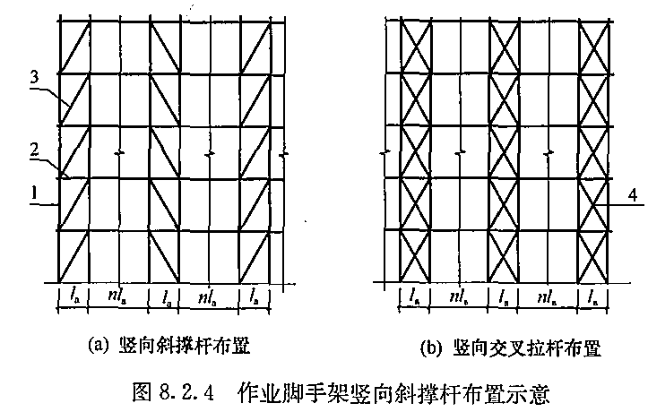
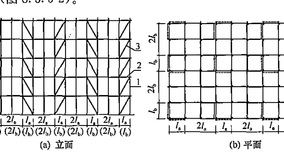
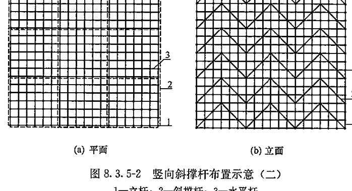
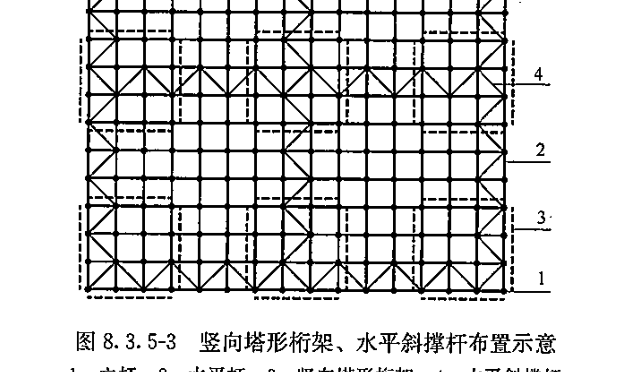

# 8 构造要求

## 8.1 一般规定

### 8.1.1 脚手架的构造和组架工艺应能满足施工需求，并应保证架体牢固、稳定。

### 8.1.2 脚手架杆件连接节点应满足其强度和转动刚度要求，应确保架体在使用期内安全，节点无松动。

### 8.1.3 脚手架所用杆件、节点连接件、构配件等应能配套使用，并应能满足各种组架方法和构造要求。

### 8.1.4 脚手架的竖向和水平剪刀撑应根据其种类、荷载、结构和构造设置，剪刀撑斜杆应与相邻立杆连接牢固；可采用斜撑杆、交叉拉杆代替剪刀撑。门式钢管脚手架设置的纵向交叉拉杆可替代纵向剪刀撑。

### 8.1.5 竹脚手架应只用于作业脚手架和落地满堂支撑脚手架，木脚手架可用于作业脚手架和支撑脚手架。竹、木脚手架的构造及节点连接技术要求应符合脚手架相关的国家现行标准的规定。

## 8.2 作业脚手架

### 8.2.1 作业脚手架的宽度不应小于0.8m，且不宜大于1.2m。作业层高度不应小于1.7m，且不宜大于2.0m。

### 8.2.2 作业脚手架应按设计计算和构造要求设置连墙件，并应符合下列规定：

            1 连墙件应采用能承受压力和拉力的构造，并应与建筑结构和架体连接牢固；
            2 连墙点的水平间距不得超过3跨，竖向间距不得超过3步，连墙点之上架体的悬臂高度不应超过2步；
            3 在架体的转角处、开口型作业脚手架端部应增设连墙件，连墙件的垂直间距不应大于建筑物层高，且不应大于4.0m。

### 8.2.3 在作业脚手架的纵向外侧立面上应设置竖向剪刀撑，并应符合下列规定：

            1 每道剪刀撑的宽度应为4跨～6跨，且不应小于6m，也不应大于9m；剪刀撑斜杆与水平面的倾角应在45°～60°之间；
            2 搭设高度在24m以下时，应在架体两端、转角及中间每隔不超过15m各设置一道剪刀撑，并由底至顶连续设置；搭设高度在24m及以上时，应在全外侧立面上由底至顶连续设置；
            3 悬挑脚手架、附着式升降脚手架应在全外侧立面上由底至顶连续设置。

### 8.2.4 当采用竖向斜撑杆、竖向交叉拉杆替代作业脚手架竖向剪刀撑时，应符合下列规定：

            1 在作业脚手架的端部、转角处应各设置一道；
            2 搭设高度在24m以下时，应每隔5跨～7跨设置一道；搭设高度在24m及以上时，应每隔1跨～3跨设置一道；相邻竖向斜撑杆应朝向对称呈八字形设置（图8.2.4）；
            3 每道竖向斜撑杆、竖向交叉拉杆应在作业脚手架外侧相邻纵向立杆间由底至顶按步连续设置。

### 8.2.5 作业脚手架底部立杆上应设置纵向和横向扫地杆。

### 8.2.6 悬挑脚手架立杆底部应与悬挑支承结构可靠连接；应在立杆底部设置纵向扫地杆，并应间断设置水平剪刀撑或水平斜撑杆。

### 8.2.7 附着式升降脚手架应符合下列规定：

            1 竖向主框架、水平支承桁架应采用桁架或刚架结构，杆件应采用焊接或螺栓连接；
            2 应设有防倾、防坠、超载、失载、同步升降控制装置，各类装置应灵敏可靠；
            3 在竖向主框架所覆盖的每个楼层均应设置一道附墙支座；每道附墙支座应能承担该机位的全部荷载；在使用工况时，竖向主框架应与附墙支座可靠固定；
            4 当采用电动升降设备时，电动升降设备连续升降距离应大于一个楼层高度，并应有可靠的制动和定位功能；
            5 防坠落装置与升降设备的附着固定应分别设置，不得固定在同一附着支座上。

### 8.2.8 作业脚手架的作业层上应满铺脚手板，并应采取可靠的连接方式与水平杆固定。当作业层边缘与建筑物间隙大于150mm时，应采取防护措施。作业层外侧应设置栏杆和挡脚板。

## 8.3 支撑脚手架

### 8.3.1 支撑脚手架的立杆间距和步距应按设计计算确定，且间距不宜大于1.5m，步距不应大于2.0m。

### 8.3.2 支撑脚手架独立架体高宽比不应大于3.0。

### 8.3.3 当有既有建筑结构时，支撑脚手架应与既有建筑结构可靠连接，连接点至架体主节点的距离不宜大于300mm，应与水平杆同层设置，并应符合下列规定：

            1 连接点竖向间距不宜超过2步；
            2 连接点水平向间距不宜大于8m。

### 8.3.4 支撑脚手架应设置竖向剪刀撑，并应符合下列规定：

            1 安全等级为Ⅱ级的支撑脚手架应在架体周边、内部纵向和横向每隔不大于9m设置一道；
            2 安全等级为Ⅰ级的支撑脚手架应在架体周边、内部纵向和横向每隔不大于6m设置一道；
            3 竖向剪刀撑斜杆间的水平距离宜为6m～9m，剪刀撑斜杆与水平面的倾角应为45°～60°。

### 8.3.5 当采用竖向斜撑杆、竖向交叉拉杆代替支撑脚手架竖向剪刀撑时，应符合下列规定：

            1 安全等级为Ⅱ级的支撑脚手架应在架体周边、内部纵向和横向每隔6m～9m设置一道；安全等级为Ⅰ级的支撑脚手架应在架体周边、内部纵向和横向每隔4m～6m设置一道。

每道竖向斜撑杆、竖向交叉拉杆可沿支撑脚手架纵向、横向每隔2跨在相邻立杆间从底至顶连续设置（图8.3.5-1）；也可沿支撑脚手架竖向每隔2步距连续设置。斜撑杆可采用八字形对称布置（图8.3.5-2）。

            2 支撑脚手架上的荷载标准值大于30kN/m²时，可采用塔形桁架矩阵式布置，塔形桁架的水平截面形状及布局，可根据荷载等因素选择（图8.3.5-3）。

### 8.3.6 支撑脚手架应设置水平剪刀撑，并应符合下列规定：

            1 安全等级为Ⅱ级的支撑脚手架宜在架顶处设置一道水平剪刀撑；
            2 安全等级为Ⅰ级的支撑脚手架应在架顶、竖向每隔不大于8m各设置一道水平剪刀撑；
            3 每道水平剪刀撑应连续设置，剪刀撑的宽度宜为6m~9m。

### 8.3.7 当采用水平斜撑杆、水平交叉拉杆代替支撑脚手架每层的水平剪刀撑时，应符合下列规定（图8.3.5-3）：

            1 安全等级为Ⅱ级的支撑脚手架应在架体水平面的周边、内部纵向和横向每隔不大于12m设置一道；
            2 安全等级为Ⅰ级的支撑脚手架宜在架体水平面的周边、内部纵向和横向每隔不大于8m设置一道；
            3 水平斜撑杆、水平交叉拉杆应在相邻立杆间连续设置。

### 8.3.8 支撑脚手架剪刀撑或斜撑杆、交叉拉杆的布置应均匀、对称。

### 8.3.9 支撑脚手架的水平杆应按步距沿纵向和横向通长连续设置，不得缺失。在支撑脚手架立杆底部应设置纵向和横向扫地杆，水平杆和扫地杆应与相邻立杆连接牢固。

### 8.3.10 安全等级为Ⅰ级的支撑脚手架顶层两步距范围内架体的纵向和横向水平杆宜按减小步距加密设置。

### 8.3.11 当支撑脚手架顶层水平杆承受荷载时，应经计算确定其杆端悬臂长度，并应小于150mm。

### 8.3.12 当支撑脚手架局部所承受的荷载较大，立杆需加密设置时，加密区的水平杆应向非加密区延伸不少于一跨；非加密区立杆的水平间距应与加密区立杆的水平间距互为倍数。

### 8.3.13 支撑脚手架的可调底座和可调托座插入立杆的长度不应小于150mm，其可调螺杆的外伸长度不宜大于300mm。当可调托座调节螺杆的外伸长度较大时，宜在水平方向设有限位措施，其可调螺杆的外伸长度应按计算确定。

### 8.3.14 当支撑脚手架同时满足下列条件时，可不设置竖向、水平剪刀撑：

            1 搭设高度小于5m，架体高宽比小于1.5；
            2 被支承结构自重面荷载不大于5kN/m²；线荷载不大于
8kN/m；
            3 杆件连接节点的转动刚度符合本标准要求；
            4 架体结构与既有建筑结构按本标准第8.3.3条的规定可靠连接；
            5 立杆基础均匀，满足承载力要求。

### 8.3.15 满堂支撑脚手架应在外侧立面、内部纵向和横向每隔6m~9m由底至顶连续设置一道竖向剪刀撑；在顶层和竖向间隔不大于8m处各设置一道水平剪刀撑，并应在底层立杆上设置纵向和横向扫地杆。

### 8.3.16 可移动的满堂支撑脚手架搭设高度不应超过12m，高宽比不应大于1.5。应在外侧立面、内部纵向和横向间隔不大于4m由底至顶连续设置一道竖向剪刀撑；应在顶层、扫地杆设置层和竖向间隔不超过2步分别设置一道水平剪刀撑。应在底层立杆上设置纵向和横向扫地杆。

### 8.3.17 可移动的满堂支撑脚手架应有同步移动控制措施。

# 9 搭设与拆除

### 9.0.1 脚手架搭设和拆除作业应按专项施工方案施工。

### 9.0.2 脚手架搭设作业前，应向作业人员进行安全技术交底。

### 9.0.3 脚手架的搭设场地应平整、坚实，场地排水应顺畅，不应有积水。脚手架附着于建筑结构处的混凝土强度应满足安全承载要求。

### 9.0.4 脚手架应按顺序搭设，并应符合下列规定：

            1 落地作业脚手架、悬挑脚手架的搭设应与工程施工同步，一次搭设高度不应超过最上层连墙件两步，且自由高度不应大于4m；
            2 支撑脚手架应逐排、逐层进行搭设；
            3 剪刀撑、斜撑杆等加固杆件应随架体同步搭设，不得滞后安装；
            4 构件组装类脚手架的搭设应自一端向另一端延伸，自下而上按步架设，并应逐层改变搭设方向；
            5 每搭设完一步架体后，应按规定校正立杆间距、步距、垂直度及水平杆的水平度。

### 9.0.5 作业脚手架连墙件的安装必须符合下列规定：

            1 连墙件的安装必须随作业脚手架搭设同步进行，严禁滞后安装；
            2 当作业脚手架操作层高出相邻连墙件2个步距及以上时，在上层连墙件安装完毕前，必须采取临时拉结措施。

### 9.0.6 悬挑脚手架、附着式升降脚手架在搭设时，其悬挑支承结构、附着支座的锚固和固定应牢固可靠。

### 9.0.7 附着式升降脚手架组装就位后，应按规定进行检验和升降调试，符合要求后方可投入使用。
### 9.0.8 脚手架的拆除作业必须符合下列规定：

            1 架体的拆除应从上而下逐层进行，严禁上下同时作业；
            2 同层杆件和构配件必须按先外后内的顺序拆除；剪刀撑、斜撑杆等加固杆件必须在拆卸至该杆件所在部位时再拆除；
            3 作业脚手架连墙件必须随架体逐层拆除，严禁先将连墙件整层或数层拆除后再拆架体。拆除作业过程中，当架体的自由端高度超过2个步距时，必须采取临时拉结措施。

### 9.0.9 模板支撑脚手架的安装与拆除作业应符合现行国家标准《混凝土结构工程施工规范》GB 50666的规定。

### 9.0.10 脚手架的拆除作业不得重锤击打、撬别。拆除的杆件、构配件应采用机械或人工运至地面，严禁抛掷。

### 9.0.11 当在多层楼板上连续搭设支撑脚手架时，应分析多层楼板间荷载传递对支撑脚手架、建筑结构的影响，上下层支撑脚手架的立杆宜对位设置。

### 9.0.12 脚手架在使用过程中应分阶段进行检查、监护、维护、保养。

# 10 质量控制

### 10.0.1 施工现场应建立健全脚手架工程的质量管理制度和搭设质量检查验收制度。

### 10.0.2 脚手架工程应按下列规定进行质量控制：

            1 对搭设脚手架的材料、构配件和设备应进行现场检验；
            2 脚手架搭设过程中应分步校验，并应进行阶段施工质量检查；
            3 在脚手架搭设完工后应进行验收，并应在验收合格后方可使用。

### 10.0.3 搭设脚手架的材料、构配件和设备应按进入施工现场的批次分品种、规格进行检验，检验合格后方可搭设施工，并应符合下列规定：

            1 新产品应有产品质量合格证，工厂化生产的主要承力杆件、涉及结构安全的构件应具有型式检验报告；
            2 材料、构配件和设备质量应符合本标准及国家现行相关标准的规定；
            3 按规定应进行施工现场抽样复验的构配件，应经抽样复验合格；
            4 周转使用的材料、构配件和设备，应经维修检验合格。

### 10.0.4 在对脚手架材料、构配件和设备进行现场检验时，应采用随机抽样的方法抽取样品进行外观检验、实量实测检验、功能测试检验。抽样比例应符合下列规定：

            1 按材料、构配件和设备的品种、规格应抽检1%~3%；
            2 安全锁扣、防坠装置、支座等重要构配件应全数检验；
            3 经过维修的材料、构配件抽检比例不应少于3%。

### 10.0.5 脚手架在搭设过程中和阶段使用前，应进行阶段施工质
量检查，确认合格后方可进行下道工序施工或阶段使用，在下列阶段应进行阶段施工质量检查：

            1 搭设场地完工后及脚手架搭设前；附着式升降脚手架支座、悬挑脚手架悬挑结构固定后；
            2 首层水平杆搭设安装后；
            3 落地作业脚手架和悬挑作业脚手架每搭设一个楼层高度，阶段使用前；
            4 附着式升降脚手架在每次提升前、提升就位后和每次下降前、下降就位后；
            5 支撑脚手架每搭设2步～4步或不大于6m高度。

### 10.0.6 脚手架在进行阶段施工质量检查时，应依据本标准及脚手架相关的国家现行标准的要求，采用外观检查、实量实测检查、性能测试等方法进行检查。

### 10.0.7 在落地作业脚手架、悬挑脚手架、支撑脚手架达到设计高度后，附着式升降脚手架安装就位后，应对脚手架搭设施工质量进行完工验收。脚手架搭设施工质量合格判定应符合下列规定：

            1 所用材料、构配件和设备质量应经现场检验合格；
            2 搭设场地、支承结构件固定应满足稳定承载的要求；
            3 阶段施工质量检查合格，符合本标准及脚手架相关的国家现行标准、专项施工方案的要求；
            4 观感质量检查应符合要求；
            5 专项施工方案、产品合格证及型式检验报告、检查记录、测试记录等技术资料应完整。

# 11 安全管理

## 11.1 一般规定

### 11.1.1 施工现场应建立脚手架工程施工安全管理体系和安全检查、安全考核制度。

### 11.1.2 脚手架工程应按下列规定实施安全管理：

            1 搭设和拆除作业前，应审核专项施工方案；
            2 应查验搭设脚手架的材料、构配件、设备检验和施工质量检查验收结果；
            3 使用过程中，应检查脚手架安全使用制度的落实情况。

### 11.1.3 脚手架的搭设和拆除作业应由专业架子工担任；并应持证上岗。

### 11.1.4 搭设和拆除脚手架作业应有相应的安全设施，操作人员应佩戴个人防护用品，穿防滑鞋。

### 11.1.5 脚手架在使用过程中，应定期进行检查，检查项目应符合下列规定：

            1 主要受力杆件、剪刀撑等加固杆件、连墙件应无缺失、无松动，架体应无明显变形；
            2 场地应无积水，立杆底端应无松动、无悬空；
            3 安全防护设施应齐全、有效，应无损坏缺失；
            4 附着式升降脚手架支座应牢固，防倾、防坠装置应处于良好工作状态，架体升降应正常平稳；
            5 悬挑脚手架的悬挑支承结构应固定牢固。

### 11.1.6 当脚手架遇有下列情况之一时，应进行检查，确认安全后方可继续使用：

            1 遇有6级及以上强风或大雨过后；
            2 冻结的地基土解冻后；
            3 停用超过1个月；
            4 架体部分拆除；
            5 其他特殊情况。

## 11.2 安全要求

### 11.2.1 脚手架作业层上的荷载不得超过设计允许荷载。

### 11.2.2 严禁将支撑脚手架、缆风绳、混凝土输送泵管、卸料平台及大型设备的支承件等固定在作业脚手架上。严禁在作业脚手架上悬挂起重设备。

### 11.2.3 雷雨天气、6级及以上强风天气应停止架上作业；雨、雪、雾天气应停止脚手架的搭设和拆除作业；雨、雪、霜后上架作业应采取有效的防滑措施，并应清除积雪。

### 11.2.4 作业脚手架外侧和支撑脚手架作业层栏杆应采用密目式安全网或其他措施全封闭防护。密目式安全网应为阻燃产品。

### 11.2.5 作业脚手架临街的外侧立面、转角处应采取硬防护措施，硬防护的高度不应小于1.2m，转角处硬防护的宽度应为作业脚手架宽度。

### 11.2.6 作业脚手架同时满载作业的层数不应超过2层。

### 11.2.7 在脚手架作业层上进行电焊、气焊和其他动火作业时，应采取防火措施，并应设专人监护。

### 11.2.8 在脚手架使用期间，立杆基础下及附近不宜进行挖掘作业。当因施工需要进行挖掘作业时，应对架体采取加固措施。

### 11.2.9 在搭设和拆除脚手架作业时，应设置安全警戒线、警戒标志，并应派专人监护，严禁非作业人员入内。

### 11.2.10 脚手架与架空输电线路的安全距离、工地临时用电线路架设及脚手架接地、防雷措施，应按现行行业标准《施工现场临时用电安全技术规范》JGJ 46执行。

### 11.2.11 支撑脚手架在施加荷载的过程中，架体下严禁有人。

### 11.2.12 当脚手架在使用过程中出现安全隐患时，应及时排除；当出现可能危及人身安全的重大隐患时，应停止架上作业，撤离作业人员，并应由工程技术人员组织检查、处置。
