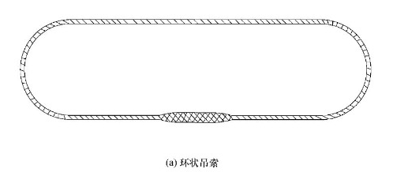
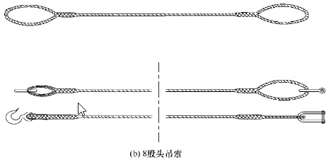
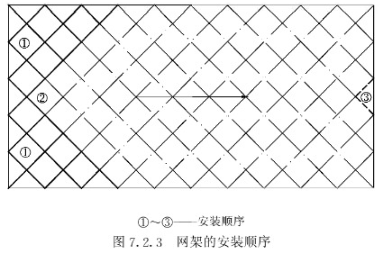

# 1 总 则

### 1.0.1 为贯彻执行安全生产方针，确保建筑工程施工起重吊装作业的安全，制定本规范。

### 1.0.2 本规范适用于建筑工程施工中的起重吊装作业。

### 1.0.3 建筑工程施工中的起重吊装作业，除应符合本规范外，尚应符合国家现行有关标准的规定。

# 2 术语和符号

## 2.1 术 语

### 2.1.1 起重吊装作业 crane lifting operation：使用起重设备将被吊物提升或移动至指定位置，并按要求安装固定的施工过程。

### 2.1.2 吊具 hoist auxiliaries：拴挂和固定被吊物的工、机具和配件，如吊索、吊钩、吊梁和卡环等。

### 2.1.3 绑扎 tightening：吊装前，用吊索和卡环按起吊规定对被吊物吊点处的捆绑。

### 2.1.4 起吊 hoisting：被吊物的吊装和空中运输过程。

### 2.1.5 溜绳 anti-sway rope：在吊升的结构物上拴绳，由下面的人拉住，防止结构物在吊升过程中任意摆动。

### 2.1.6 超载 overload：超过或大于起重设备的额定起重量。

### 2.1.7 临时固定 temporary holding or fixation：对搁置就位的被吊物进行临时性拉结和支撑的措施。

### 2.1.8 永久固定 permanent holding or fixation：校正完成后，按设计要求进行的永久性的连接固定。

### 2.1.9 空载 no-load：起重机械没有负载的工作状态。

### 2.1.10 缆风绳 balance rope：用来保证安装的构件或设备在操作过程中保持稳定的钢丝绳，上端与安装对象拉结，下端与地锚固定。
      
### 2.1.11 破断拉力 tensile strength of rope：按规定的试验方法把绳索拉断所需要的力。

### 2.1.12 钢丝绳牵引力 tensile force of steel rope：重物起升后，卷筒上的钢丝绳所产生的拉力。

### 2.1.13 安全绳 safety rope：用于防止起重人员在高空作业时发生坠落事故的绳索的总称。

## 2.2 符 号

A——面积；
a——距离；
b——厚度、宽度；
D、d——直径；
f——承载力设计值；
F——拉力、阻力；
[F]——容许拉力；
H——高度；
i——传动比；
K——系数；
L——长度；
M——弯矩；
N——轴向力；
P——功率、水平反力；
Q——计算荷载、重量；
T——摩擦阻力；
v——速度；
W——截面抵抗矩；
γ——重力密度；
η——效率、降低系数；
μ——摩擦系数；
σ——正应力；
τ——剪应力；
φ——内摩擦角；
ω——转速。

# 3 基本规定

### 3.0.1 起重吊装作业前，必须编制吊装作业的专项施工方案，并应进行安全技术措施交底；作业中，未经技术负责人批准，不得随意更改。

### 3.0.2 起重机操作人员、起重信号工、司索工等特种作业人员必须持特种作业资格证书上岗。严禁非起重机驾驶人员驾驶、操作起重机。

### 3.0.3 起重吊装作业前，应检查所使用的机械、滑轮、吊具和地锚等，必须符合安全要求。

### 3.0.4 起重作业人员必须穿防滑鞋、戴安全帽，高处作业应佩挂安全带，并应系挂可靠，高挂低用。

### 3.0.5 起重设备的通行道路应平整，承载力应满足设备通行要求。吊装作业区域四周应设置明显标志，严禁非操作人员入内。夜间不宜作业，当确需夜间作业时，应有足够的照明。

### 3.0.6 登高梯子的上端应固定，高空用的吊篮和临时工作台应固定牢靠，并应设不低于1.2m的防护栏杆。吊篮和工作台的脚手板应铺平绑牢，严禁出现探头板。吊移操作平台时，平台上面严禁站人。当构件吊起时，所有人员不得站在吊物下方，并应保持一定的安全距离。

### 3.0.7 绑扎所用的吊索、卡环、绳扣等的规格应根据计算确定。起吊前，应对起重机钢丝绳及连接部位和吊具进行检查。

### 3.0.8 高空吊装屋架、梁和采用斜吊绑扎吊装柱时，应在构件两端绑扎溜绳，由操作人员控制构件的平衡和稳定。

### 3.0.9 构件的吊点应符合设计规定。对异形构件或当无设计规定时，应经计算确定，保证构件起吊平稳。

### 3.0.10 安装所使用的螺栓、钢楔、木楔、钢垫板和垫木等的材质应符合设计要求及国家现行标准的有关规定。

### 3.0.11 吊装大、重构件和采用新的吊装工艺时，应先进行试吊，确认无问题后，方可正式起吊。

### 3.0.12 大雨、雾、大雪及六级以上大风等恶劣天气应停止吊装作业。雨雪后进行吊装作业时，应及时清理冰雪并应采取防滑和防漏电措施，先试吊，确认制动器灵敏可靠后方可进行作业。

### 3.0.13 吊起的构件应确保在起重机吊杆顶的正下方，严禁采用斜拉、斜吊，严禁起吊埋于地下或粘结在地上的构件。

### 3.0.14 起重机靠近架空输电线路作业或在架空输电线路下行走时，与架空输电线的安全距离应符合现行行业标准《施工现场临时用电安全技术规范》JGJ 46 和其他相关标准的规定。

### 3.0.15 当采用双机抬吊时，宜选用同类型或性能相近的起重机，负载分配应合理，单机载荷不得超过额定起重量的80%。两机应协调工作，起吊的速度应平稳缓慢。

### 3.0.16 起吊过程中，在起重机行走、回转、俯仰吊臂、起落吊钩等动作前，起重司机应鸣声示意。一次只宜进行一个动作，待前一动作结束后，再进行下一动作。

### 3.0.17 开始起吊时，应先将构件吊离地面200mm～300mm后暂停，检查起重机的稳定性、制动装置的可靠性、构件的平衡性和绑扎的牢固性等，确认无误后，方可继续起吊。已吊起的构件不得长久停滞在空中。严禁超载和吊装重量不明的重型构件和设备。

### 3.0.18 严禁在吊起的构件上行走或站立，不得用起重机载运人员，不得在构件上堆放或悬挂零星物件。严禁在已吊起的构件下面或起重臂下旋转范围内作业或行走。起吊时应匀速，不得突然制动。回转时动作应平稳，当回转未停稳前不得做反向动作。

### 3.0.19 暂停作业时，对吊装作业中未形成稳定体系的部分，必须采取临时固定措施。

### 3.0.20 高处作业所使用的工具和零配件等，应放在工具袋（盒）内，并严禁抛掷。

### 3.0.21 吊装中的焊接作业，应有严格的防火措施，并应设专人看护。在作业部位下面周围10m范围内不得有人。

### 3.0.22 已安装好的结构构件，未经有关设计和技术部门批准不得随意凿洞开孔。严禁在其上堆放超过设计荷载的施工荷载。

### 3.0.23 对临时固定的构件，必须在完成了永久固定，并经检查确认无误后，方可解除临时固定措施。

### 3.0.24 对起吊物进行移动、吊升、停止、安装时的全过程应采用旗语或通用手势信号进行指挥，信号不明不得启动，上下联系应相互协调，也可采用通信工具。

# 4 起重机械和索具设备

## 4.1 起重机械

### 4.1.1 凡新购、大修、改造、新安装及使用、停用时间超过规定的起重机械，均应按有关规定进行技术检验，合格后方可使用。

### 4.1.2 起重机在每班开始作业时，应先试吊，确认制动器灵敏可靠后，方可进行作业。作业时不得擅自离岗和保养机车。

### 4.1.3 起重机的选择应满足起重量、起重高度、工作半径的要求，同时起重臂的最小杆长应满足跨越障碍物进行起吊时的操作要求。

### 4.1.4 自行式起重机的使用应符合下列规定：
      1 起重机工作时的停放位置应按施工方案与沟渠、基坑保持安全距离，且作业时不得停放在斜坡上。
      2 作业前应将支腿全部伸出，并应支垫牢固。调整支腿应在无载荷时进行，并将起重臂全部缩回转至正前或正后，方可调整。作业过程中发现支腿沉陷或其他不正常情况时，应立即放下吊物，进行调整后，方可继续作业。
      3 启动时应先将主离合器分离，待运转正常后再合上主离合器进行空载运转，确认正常后，方可开始作业。
      4 工作时起重臂的仰角不得超过其额定值；当无相应资料时，最大仰角不得超过78°，最小仰角不得小于45°。
      5 起重机变幅应缓慢平稳，严禁快速起落。起重臂未停稳前，严禁变换挡位和同时进行两种动作。
      6 当起吊荷载达到或接近最大额定荷载时，严禁下落起重臂。
      7 汽车式起重机进行吊装作业时，行走用的驾驶室内不得有人，吊物不得超越驾驶室上方，并严禁带载行驶。
      8 伸缩式起重臂的伸缩，应符合下列规定：
            1）起重臂的伸缩，应在起吊前进行。当起吊过程中需伸缩时，起吊荷载不得大于其额定值的50%。
            2）起重臂伸出后的上节起重臂长度不得大于下节起重臂长度，且起重臂伸出后的仰角不得小于使用说明中相应的规定值。
            3）在伸起重臂同时下降吊钩时，应满足使用说明中动、定滑轮组间的最小安全距离规定。
      9 起重机制动器的制动鼓表面磨损达到2.0mm或制动带磨损超过原厚度50%时，应予更换。
      10 起重机的变幅指示器、力矩限制器和限位开关等安全保护装置，应齐全完整、灵活可靠，严禁随意调整、拆除，不得以限位装置代替操作机构。
      11 作业完毕或下班前，应按规定将操作杆置于空挡位置，起重臂应全部缩回原位，转至顺风方向，并应降至40°～60°之间，收紧钢丝绳，挂好吊钩或将吊钩落地，然后将各制动器和保险装置固定，关闭发动机，驾驶室加锁后，方可离开。

### 4.1.5 塔式起重机的使用应符合国家现行标准《塔式起重机安全规程》GB 5144、《建筑施工塔式起重机安装、使用、拆卸安全技术规程》JGJ 196 及《建筑机械使用安全技术规程》JGJ 33 中的相关规定。

### 4.1.6 拔杆式起重机的制作安装应符合下列规定：
      1 拔杆式起重机应进行专门设计和制作，经严格的测试、试运转和技术鉴定合格后，方可投入使用。
      2 安装时的地基、基础、缆风绳和地锚等设施，应经计算确定。缆风绳与地面的夹角应在30°～45°之间。缆风绳不得与供电线路接触，在靠近电线处，应装设由绝缘材料制作的护线架。

### 4.1.7 拔杆式起重机的使用应符合下列规定：
      1 在整个吊装过程中，应派专人看守地锚。每进行一段工作或大雨后，应对拔杆、缆风绳、索具、地锚和卷扬机等进行详细检查，发现有摆动、损坏等情况时，应立即处理解决。
      2 拔杆式起重机移动时，其底座应垫以足够的承重枕木排和滚杠，并将起重臂收紧，处于移动方向的前方，倾斜不得超过10°，移动时拔杆不得向后倾斜，收放缆风绳应配合一致。

## 4.2 绳 索

### 4.2.1 吊装作业中使用的白棕绳应符合下列规定：
      1 应由剑麻的茎纤维搓成，并不得涂油。其规格和破断拉力应符合产品说明书的规定。
      2 只可用作受力不大的缆风绳和溜绳等。白棕绳的驱动力只能是人力，不得用机械动力驱动。
      3 穿绕白棕绳的滑轮直径，应大于白棕绳直径的10倍。麻绳有结时，不得穿过滑车狭小之处。长期在滑车使用的白棕绳，应定期改变穿绳方向。
      4 整卷白棕绳应根据需要长度切断绳头，切断前应用铁丝或麻绳将断口扎紧。
      5 使用中发生的扭结应立即抖直。当有局部损伤时，应切去损伤部分。
      6 当绳长度不够时，应采用编接接长。
      7 捆绑有棱角的物件时，应垫木板或麻袋等物。
      8 使用中不得在粗糙的构件上或地下拖拉，并应防止砂、石屑嵌入。
      9 编接绳头绳套时，编接前每股头上应用绳扎紧，编接后相互搭接长度：绳套不得小于白棕绳直径的15倍；绳头不得小于30倍。
      10 白棕绳在使用时不得超过其容许拉力，容许拉力应按下式计算：
            [Fz] = Fz / K （4.2.1）
            式中：[Fz]——白棕绳的容许拉力（kN）；Fz——白棕绳的破断拉力（kN）；K——白棕绳的安全系数，应按表4.2.1采用。
                  表4.2.1 白棕绳的安全系数
                  ┌───────────────────────────────────────────────┬──────────┐
                  │用途                                           │ 安全系数  │
                  ├───────────────────────────────────────────────┼──────────┤
                  │一般小型构件（过梁、空心板及5kN重以下等构件）      │   ≥6     │
                  │5kN～10kN重吊装作业                             │   ≥10    │
                  │作捆绑吊索                                      │   ≥12    │
                  │作缆风绳                                        │   ≥6     │
                  └───────────────────────────────────────────────┴──────────┘
                  表格解释：一般小型构件，如过梁、空心板及5kN重以下等，安全系数≥6；5kN～10kN重的吊装作业，安全系数≥10；作捆绑吊索作业，安全系数≥12；作缆风绳作业，安全系数≥6。
### 4.2.2 采用纤维绳索、聚酯复丝绳索应符合现行国家标准《纤维绳索 通用要求》GB/T 21328、《聚酯复丝绳索》GB/T 11787 和《绳索 有关物理和机械性能的测定》GB/T 8834 的相关规定。

### 4.2.3 吊装作业中钢丝绳的使用、检验、破断拉力值和报废等应符合现行国家标准《重要用途钢丝绳》GB 8918、《一般用途钢丝绳》GB/T 20118 和《起重机 钢丝绳保养、维护、安装、检验和报废》GB/T 5972 中的相关规定。

## 4.3 吊 索

### 4.3.1 钢丝绳吊索应符合下列规定：
      1 钢丝绳吊索应符合现行国家标准《一般用途钢丝绳吊索特性和技术条件》GB/T 16762、插编索扣应符合现行国家标准《钢丝绳吊索 插编索扣》GB/T 16271 中所规定的一般用途钢丝绳吊索特性和技术条件等的规定。
      2 吊索宜采用6×37型钢丝绳制作成环式或8股头式（图4.3.1），其长度和直径应根据吊物的几何尺寸、重量和所用的吊装工具、吊装方法确定。使用时可采用单根、双根、四根或多根悬吊形式。
      3 吊索的绳环或两端的绳套可采用压接接头，压接接头的长度不应小于钢丝绳直径的20倍，且不应小于300mm。8股头吊索两端的绳套可根据工作需要装上桃形环、卡环或吊钩等吊索附件。
      4 当利用吊索上的吊钩、卡环钩挂重物上的起重吊环时，吊索的安全系数不应小于6；当用吊索直接捆绑重物，且吊索与重物棱角间已采取妥善的保护措施时，吊索的安全系数应取6～8；当起吊重、大或精密的重物时，除应采取妥善保护措施外，吊索的安全系数应取10。
      5 吊索与所吊构件间的水平夹角宜大于45°。计算拉力时可按本规范附录A表A.1、表A.2选用。

### 4.3.2 吊索附件应符合下列规定：
      1 套环应符合现行国家标准《钢丝绳用普通套环》GB/T 5974.1 和《钢丝绳用重型套环》GB/T 5974.2 的规定。
      2 使用套环时，其起吊的承载能力，应将套环的承载能力与表4.3.2中降低后的钢丝绳承载能力相比较，采用小值。
            表4.3.2 使用套环时的钢丝绳强度降低率
            ┌────────────────────┬──────────────────────┐
            │ 钢丝绳直径（mm）   │ 绕过套环后强度降低率（%） │
            ├────────────────────┼──────────────────────┤
            │ 10～16             │ 5                    │
            │ 19～28             │ 15                   │
            │ 32～38             │ 20                   │
            │ 42～50             │ 25                   │
            └────────────────────┴──────────────────────┘
            表格解释：钢丝绳直径10～16mm时，绕过套环后强度降低率为5%；钢丝绳直径19～28mm时，绕过套环后强度降低率为15%；钢丝绳直径32～38mm时，绕过套环后强度降低率为20%；钢丝绳直径42～50mm时，绕过套环后强度降低率为25%。
      3 吊钩应有制造厂的合格证明书，表面应光滑，不得有裂纹、刻痕、剥裂、锐角等现象。吊钩每次使用前应检查一次，不合格者应停止使用。
      4 活动卡环在绑扎时，起吊后销子的尾部应朝下，吊索在受力后应压紧销子，其容许荷载应按出厂说明书采用。

### 4.3.3 横吊梁应采用Q235或Q345钢材，应经过设计计算，计算方法应按本规范附录B进行，并应按设计进行制作。
## 4.4 起重吊装设备

### 4.4.1 滑轮和滑轮组的使用应符合下列规定：
      1 使用前，应检查滑轮的轮槽、轮轴、夹板、吊钩等各部件，不得有裂缝和损伤，滑轮转动应灵活，润滑良好。
      2 滑轮应按本规范附录C表C.0.1中的容许荷载值使用。对起重量不明的滑轮，应先进行估算，并经负载试验合格后，方可使用。
      3 滑轮组绳索宜采用顺穿法，由三对以上动、定滑轮组成的滑轮组应采用花穿法。滑轮组穿绕后，应开动卷扬机慢慢将钢丝绳收紧和试吊，检查有无卡绳、磨绳的地方，绳间摩擦及其他部分应运转良好，如有问题，应立即修正。
      4 滑轮的吊钩或吊环应与起吊构件的重心在同一垂直线上。
      5 滑轮使用前后应刷洗干净，擦油保养，轮轴应经常加油润滑，严禁锈蚀和磨损。
      6 对重要的吊装作业、较高处作业或在起重作业量较大时，不宜用钩型滑轮，应使用吊环、链环或吊梁型滑轮。
      7 滑轮组的上下定、动滑轮之间安全距离不应小于1.5m。
      8 对暂不使用的滑轮，应存放在干燥少尘的库房内，下面垫以木板，并应每3个月检查保养一次。
      9 滑轮和滑轮组的跑头拉力、牵引行程和速度应符合下列规定：
            1）滑轮组的跑头拉力应按下式计算：
            F = αQ                              （4.4.1-1）
            式中：F——跑头拉力（kN）；
                  α——滑轮组的省力系数，其值可按本规范附录C表C.0.2选用；
                  Q——计算荷载（kN），等于吊重乘以动力系数1.5。
            2）滑轮跑头牵引行程和速度应按下列公式计算：
            u = mh                              （4.4.1-2）
            v = mv1                             （4.4.1-3）
            式中：u——跑头牵引行程（m）；
                  m——滑轮组工作绳数；
                  h——吊件的上升行程（m）；
                  v——跑头的牵引速度（m/s）；
                  v1——吊件的上升速度（m/s）。

### 4.4.2 卷扬机的使用应符合下列规定：
      1 手动卷扬机不得用于大型构件吊装，大型构件吊装应采用电动卷扬机。
      2 卷扬机的基础应平稳牢固，用于锚固的地锚应可靠，防止发生倾覆和滑动。
      3 卷扬机使用前，应对各部分详细检查，确保棘轮装置和制动器完好，变速齿轮沿轴转动，啮合正确，无杂音和润滑良好，发现问题，严禁使用。
      4 卷扬机应安装在吊装区外，水平距离应大于构件的安装高度，并搭设防护棚，保证操作人员能清楚地看见指挥人员的信号。当构件被吊到安装位置时，操作人员的视线仰角应小于30°。
      5 导向滑轮严禁使用开口拉板式滑轮。滑轮到卷筒中心的距离，对带槽卷筒应大于卷筒宽度的15倍；对无槽卷筒应大于20倍，当钢丝绳处在卷筒中间位置时，应与卷筒的轴心线垂直。
      6 钢丝绳在卷筒上应逐圈靠紧，排列整齐，严禁互相错叠、离缝和挤压。钢丝绳缠满后，卷筒凸缘应高出2倍及以上钢丝绳直径，钢丝绳全部放出时，钢丝绳在卷筒上保留的安全圈不应少于5圈。
      7 在制动操纵杆的行程范围内不得有障碍物。作业过程中，操作人员不得离开卷扬机，严禁在运转中用手或脚去拉、踩钢丝绳，严禁跨越卷扬机钢丝绳。
      8 卷扬机的电气线路应经常检查，电机应运转良好，电磁抱闸和接地应安全有效，不得有漏电现象。

### 4.4.3 电动卷扬机的牵引力和钢丝绳速度应符合下列规定：
      1）卷筒上的钢丝绳牵引力应按下列公式计算：
      F = 1.02 × P_H η / v               （4.4.3-1）
      η = η0 × η1 × η2 × … × ηn          （4.4.3-2）
      式中：F——牵引力（kN）；
            P_H——电动机的功率（kW）；
            v——钢丝绳速度（m/s）；
            η——总效率；
            η0——卷筒效率，当卷筒装在滑动轴承上时，取η0=0.94；当装在滚动轴承上时，取η0=0.96；
            η1, η2…ηn——传动机构效率，按表4.4.3选用。
                  表4.4.3 传动机构的效率
                  ┌──────────┬──────────────┬──────────────┬──────────┐
                  │ 传 动 机 构              │              │ 效 率    │
                  ├──────────┼──────────────┼──────────────┼──────────┤
                  │ 卷筒      │ 滑 动 轴 承  │              │0.94～0.96│
                  │          │ 滚 动 轴 承  │              │0.96～0.98│
                  ├──────────┼──────────────┼──────────────┼──────────┤
                  │一对圆柱齿│ 开式传动     │ 滑动轴承     │0.93～0.95│
                  │ 轮传动   │              │ 滚动轴承     │0.95～0.96│
                  │          ├──────────────┼──────────────┼──────────┤
                  │          │ 闭式传动     │ 滑动轴承     │0.95～0.96│
                  │          │ 稀油润滑     │ 滚动轴承     │0.96～0.98│
                  └──────────┴──────────────┴──────────────┴──────────┘
                  表格解释：
                  1.当传动机构为滑动轴承的卷筒时，其效率为0.94～0.96；滚动轴承时，其效率为0.96～0.98；
                  2.当传动机构为圆柱齿轮且开式传动、滑动轴承时，其效率为0.93～0.95；滚动轴承时，其效率为0.95～0.96；
                  3.当传动机构为圆柱齿轮且闭式传动、滑动轴承时，其效率为0.95～0.96；滚动轴承时，其效率为0.96～0.98；
      2）钢丝绳速度应按下列公式计算：
            v = πDω                            （4.4.3-3）
            ω = ω_H i / 60                     （4.4.3-4）
            i = n_Z / n_B                       （4.4.3-5）
            式中：v——钢丝绳速度（m/s）；
                  D——卷筒直径（m）；
                  ω——卷筒转速（r/s）；
                  ω_H——电动机转速（r/s）；
                  i——传动比；
                  n_Z——所有主动轮齿数的乘积；
                  n_B——所有被动轮齿数的乘积。

### 4.4.4 捯链的使用应符合下列规定：
      1 使用前应进行检查，捯链的吊钩、链条、轮轴、链盘等应无锈蚀、裂纹、损伤，传动部分应灵活正常。
      2 起吊构件至起重链条受力后，应仔细检查，确保齿轮啮合良好，自锁装置有效后，方可继续作业。
      3 应均匀和缓地拉动链条，并应与轮盘方向一致，不得斜向拽动。
      4 捯链起重量或起吊构件的重量不明时，只可一人拉动链条，一人拉不动应查明原因，此时严禁两人或多人齐拉。
      5 齿轮部分应经常加油润滑，棘爪、棘爪弹簧和棘轮应经常检查，防止制动失灵。
      6 捯链使用完毕后应拆卸清洗干净，上好润滑油，装好后套上塑料罩挂好。

### 4.4.5 手扳葫芦应符合下列规定：
      1 只可用于吊装中收紧缆风绳和升降吊篮使用。
      2 使用前，应仔细检查确认自锁夹钳装置夹紧钢丝绳后能往复作直线运动，不满足要求，严禁使用。使用时，待其受力后应检查确认运转自如，无问题后，方可继续作业。
      3 用于吊篮时，应在每根钢丝绳处拴一根保险绳，并将保险绳的另一端固定在可靠的结构上。
      4 使用完毕后，应拆卸、清洗、上油、安装复原，妥善保管。

### 4.4.6 千斤顶的使用应符合下列规定：
      1 使用前后应拆洗干净，损坏和不符合要求的零件应更换，安装好后应检查各部位配件运转的灵活性，对油压千斤顶应检查阀门、活塞、皮碗的完好程度，油液干净程度和稠度应符合要求，若在负温情况下使用，油液应变稠、不结冻。
      2 千斤顶的选择，应符合下列规定：
            1）千斤顶的额定起重量应大于起重构件的重量，起升高度应满足要求，其最小高度应与安装净空相适应。
            2）采用多台千斤顶联合顶升时，应选用同一型号的千斤顶，并应保持同步，每台的额定起重量不得小于所分担重量的1.2倍。
      3 千斤顶应放在平整坚实的地面上，底座下应垫以枕木或钢板。与被顶升构件的光滑面接触时，应加垫硬木板防滑。
      4 设顶处应传力可靠，载荷的传力中心应与千斤顶轴线一致，严禁载荷偏斜。
      5 顶升时，应先轻微顶起后停住，检查千斤顶承力、地基、垫木、枕木垛有无异常或千斤顶歪斜，出现异常，应及时处理后方可继续工作。
      6 顶升过程中，不得随意加长千斤顶手柄或强力硬压，每次顶升高度不得超过活塞上的标志，且顶升高度不得超过螺丝杆或活塞高度的3/4。
      7 构件顶起后，应随起随搭枕木垛和加设临时短木块，其短木块与构件间的距离应随时保持在50mm以内。

## 4.5 地 锚

### 4.5.1 立式地锚的构造应符合下列规定：
      1 应在枕木、圆木、方 木地龙柱的下部后侧和中部前侧设置挡木，并贴紧土壁，坑内应回填土石并夯实，表面略高于自然地坪。
      2 地坑深度应大于1.5m，地龙柱应露出地面0.4m～1.0m，并略向后倾斜。
      3 使用枕木或方木做地龙柱时，应使截面的长边与受力方向一致，作用的荷载宜与地龙柱垂直。
      4 单柱立式地锚承载力不够时，可在受力方向后侧增设一个或两个单柱立式地锚，并用绳索连接，使其共同受力。
      5 各种立式地锚的构造参数及计算方法应符合本规范附录D的规定。

### 4.5.2 桩式地锚的构造应符合下列规定：
      1 应采用直径180mm～330mm的松木或杉木做地锚桩，略向后倾斜打入地层中，并应在其前方距地面0.4m～0.9m深处，紧贴桩身埋置1m长的挡木一根。
      2 桩入土深度不应小于1.5m，地锚的钢丝绳应拴在距地面不大于300mm处。
      3 荷载较大时，可将两根或两根以上的桩用绳索与木板将其连在一起使用。
      4 各种桩式地锚的构造参数及计算方法应符合本规范附录D的规定。

### 4.5.3 卧式地锚的构造应符合下列规定：
      1 钢丝绳应根据作用荷载大小，系结在横置木中部或两侧，并应采用土石回填夯实。
      2 木料尺寸和数量应根据作用荷载的大小和土壤的承载力经过计算确定。
      3 木料横置埋入深度宜为1.5m～3.5m。当作用荷载超过75kN时，应在横置木料顶部加压板；当作用荷载超过150kN时，应在横置木料前增设挡板立柱和挡板。
      4 当卧式地锚作用荷载较大时，地锚的钢丝绳应采用钢拉杆代替。
      5 卧式地锚的构造参数及计算方法应符合本规范附录D的规定。

### 4.5.4 各式地锚的使用应符合下列规定：
      1 地锚采用的木料应使用剥皮落叶松、杉木。严禁使用油松、杨木、柳木、桦木、椴木和腐朽、多节的木料。
      2 绑扎地锚钢丝绳的绳环应牢固可靠，横卧木四角应采用长500mm的角钢加固，并应在角钢外再用长300mm的半圆钢管保护。
      3 钢丝绳的方向应与地锚受力方向一致。
      4 地锚使用前应进行试拉，合格后方可使用。埋设不明的地锚未经试拉不得使用。
      5 地锚使用时应指定专人检查、看守，如发现变形应立即处理或加固。

# 5 混凝土结构吊装

## 5.1 一般规定

### 5.1.1 构件的运输应符合下列规定：
      1 构件运输应严格执行所制定的运输技术措施。
      2 运输道路应平整，有足够的承载力、宽度和转弯半径。
      3 高宽比较大的构件的运输，应采用支承框架、固定架、支撑或用捯链等予以固定，不得悬吊或堆放运输。支承架应进行设计计算，应稳定、可靠和装卸方便。
      4 当大型构件采用半拖或平板车运输时，构件支承处应设转向装置。
      5 运输时，各构件应拴牢于车厢上。

### 5.1.2 构件的堆放应符合下列规定：
      1 构件堆放场地应压实平整，周围应设排水沟。
      2 构件应按设计支承位置堆放平稳，底部应设置垫木。对不规则的柱、梁、板，应专门分析确定支承和加垫方法。
      3 屋架、薄腹梁等重心较高的构件，应直立放置，除设支承垫木外，应在其两侧设置支撑使其稳定，支撑不得少于2道。
      4 重叠堆放的构件应采用垫木隔开，上下垫木应在同一垂线上。堆放高度梁、柱不宜超过2层；大型屋面板不宜超过6层。堆垛间应留2m宽的通道。
      5 装配式大板应采用插放法或背靠法堆放，堆放架应经设计计算确定。

### 5.1.3 构件翻身应符合下列规定：
      1 柱翻身时，应确保本身能承受自重产生的正负弯矩值。其两端距端面1/5～1/6柱长处应垫方木或枕木垛。
      2 屋架或薄腹梁翻身时应验算抗裂度，不够时应予加固。当屋架或薄腹梁高度超过1.7m时，应在表面加绑木、竹或钢管横杆增加屋架平面刚度，并在屋架两端设置方木或枕木垛，其上表面应与屋架底面齐平，且屋架间不得有粘结现象。翻身时，应做到一次扶直或将屋架转到与地面夹角达到70°后，方可刹住。
      
### 5.1.4 构件拼装应符合下列规定：
      1 当采用平拼时，应防止在翻身过程中发生损坏和变形；当采用立拼时，应采取可靠的稳定措施。当大跨度构件进行高空立拼时，应搭设带操作台的拼装支架。
      2 当组合屋架采用立拼时，应在拼架上设置安全挡木。

### 5.1.5 吊点设置和构件绑扎应符合下列规定：
      1 当构件无设计吊环（点）时，应通过计算确定绑扎点的位置。绑扎方法应可靠，且摘钩应简便安全。
      2 当绑扎竖直吊升的构件时，应符合下列规定：
            1）绑扎点位置应略高于构件重心。
            2）在柱不翻身或吊升中不会产生裂缝时，可采用斜吊绑扎法。
            3）天窗架宜采用四点绑扎。
      3 当绑扎水平吊升的构件时，应符合下列规定：
            1）绑扎点应按设计规定设置。无规定时，最外吊点应在距构件两端1/5～1/6构件全长处进行对称绑扎。
            2）各支吊索内力的合力作用点应处在构件重心线上。
            3）屋架绑扎点宜在节点上或靠近节点。
      4 绑扎应平稳、牢固，绑扎钢丝绳与物体间的水平夹角应为：构件起吊时不得小于45°；构件扶直时不得小于60°。

### 5.1.6 构件起吊前，其强度应符合设计规定，并应将其上的模板、灰浆残渣、垃圾碎块等全部清除干净。

### 5.1.7 楼板、屋面板吊装后，对相互间或其上留有的空隙和洞口，应设置盖板或围护，并应符合现行行业标准《建筑施工高处作业安全技术规范》JGJ 80 的规定。

### 5.1.8 多跨单层厂房宜先吊主跨，后吊辅助跨；先吊高跨，后吊低跨。多层厂房宜先吊中间，后吊两侧，再吊角部，且应对称进行。

### 5.1.9 作业前应清除吊装范围内的障碍物。

## 5.2 单层工业厂房结构吊装

### 5.2.1 柱的吊装应符合下列规定：
      1 柱的起吊方法应符合施工组织设计规定。
      2 柱就位后，应将柱底落实，每个柱面应采用不少于两个钢楔楔紧，但严禁将楔子重叠放置。初步校正垂直后，打紧楔子进行临时固定。对重型柱或细长柱以及多风或风大地区，在柱上部应采取稳妥的临时固定措施，确认牢固可靠后，方可指挥脱钩。
      3 校正柱时，严禁将楔子拔出，在校正好一个方向后，应稍打紧两面相对的四个楔子，方可校正另一个方向。待完全校正好后，除将所有楔子按规定打紧外，还应采用石块将柱底脚与杯底四周全部楔紧。采用缆风或斜撑校正柱时，应在杯口第二次浇筑的混凝土强度达到设计强度的75%时，方可拆除缆风或斜撑。
      4 杯口内应采用强度高一级的细石混凝土浇筑固定。采用木楔或钢楔作临时固定时，应分二次浇筑，第一次灌至楔子下端，待达到设计强度30%以上，方可拔出楔子，再二次浇筑至基础顶；当使用混凝土楔子时，可一次浇筑至基础顶面。混凝土强度应作试块检验，冬期施工时，应采取冬期施工措施。

### 5.2.2 梁的吊装应符合下列规定：
      1 梁的吊装应在柱永久固定和柱间支撑安装后进行。吊车梁的吊装，应在基础杯口二次浇筑的混凝土达到设计强度50%以上，方可进行。
      2 重型吊车梁应边吊边校，然后再进行统一校正。
      3 梁高和底宽之比大于4时，应采用支撑撑牢或用8号钢丝将梁捆于稳定的构件上后，方可摘钩。
      4 吊车梁的校正在梁吊装完，也可在屋面构件校正并最后固定后进行。校正完毕后，应立即焊接固定。

### 5.2.3 屋架吊装应符合下列规定：
      1 进行屋架或屋面梁垂直度校正时，在跨中，校正人员应沿屋架上弦绑扎的栏杆行走，栏杆高度不得低于1.2m；在两端，应站在悬挂于柱顶上的吊篮上进行，严禁站在柱顶操作。垂直度校正完毕并进行可靠固定后，方可摘钩。
      2 吊装第一榀屋架和天窗架时，应在其上弦杆拴缆风绳作临时固定。缆风绳应采用两侧布置，每边不得少于2根。当跨度大于18m时，宜增加缆风绳数，间距不得大于6m。

### 5.2.4 天窗架与屋面板分别吊装时，天窗架应在该榀屋架上的屋面板吊装完毕后进行，并经临时固定和校正后，方可脱钩焊接固定。

### 5.2.5 校正完毕后应按设计要求进行永久性的接头固定。

### 5.2.6 屋架和天窗架上的屋面板吊装，应从两边向屋脊对称进行，且不得用撬杠沿板的纵向撬动。就位后应采用铁片垫实脱钩，并应立即电焊固定，应至少保证3点焊牢。

### 5.2.7 托架吊装就位校正后，应立即支模浇灌接头混凝土进行固定。

### 5.2.8 支撑系统应先安装垂直支撑，后安装水平支撑；先安装中部支撑，后安装两端支撑，并与屋架、天窗架和屋面板的吊装交替进行。

## 5.3 多层框架结构吊装

### 5.3.1 框架柱吊装应符合下列规定：
      1 上节柱的安装应在下节柱的梁和柱间支撑安装焊接完毕、下节柱接头混凝土达到设计强度的75%及以上后，方可进行。
      2 多机抬吊多层H型框架柱时，递送作业的起重机应使用横吊梁起吊。
      3 柱就位后应随即进行临时固定和校正。榫式接头的，应对称施焊四角钢筋接头后方可松钩；钢板接头的，应各边分层对称施焊2/3的长度后方可脱钩；H型柱则应对称焊好四角钢筋后方可脱钩。
      4 重型或较长柱的临时固定，应在柱间加设水平管式支撑或设缆风绳。
      5 吊装中用于保护接头钢筋的钢管或垫木应捆扎牢固。

### 5.3.2 楼层梁的吊装应符合下列规定：
      1 吊装明牛腿式接头的楼层梁时，应在梁端和柱牛腿上预埋的钢板焊接后方可脱钩。
      2 吊装齿槽式接头的楼层梁时，应将梁端的上部接头焊好两根后方可脱钩。

### 5.3.3 楼层板的吊装应符合下列规定：
      1 吊装两块以上的双T形板时，应将每块的吊索直接挂在起重机吊钩上。
      2 板重在5kN以下的小型空心板或槽形板，可采用平吊或兜吊，但板的两端应保证水平。
      3 吊装楼层板时，严禁采用叠压式，并严禁在板上站人、放置小车等重物或工具。
      
## 5.4 墙板结构吊装

### 5.4.1 装配式大板结构吊装应符合下列规定：
      1 吊装大板时，宜从中间开始向两端进行，并应按先横墙后纵墙，先内墙后外墙，最后隔断墙的顺序逐间封闭吊装。
      2 吊装时应保证坐浆密实均匀。
      3 当采用横吊梁或吊索时，起吊应垂直平稳，吊索与水平线的夹角不宜小于60°。
      4 大板宜随吊随校正。就位后偏差过大时，应将大板重新吊起就位。
      5 外墙板应在焊接固定后方可脱钩，内墙和隔墙板可在临时固定可靠后脱钩。
      6 校正完后，应立即焊接预埋筋，待同一层墙板吊装和校正完后，应随即浇筑墙板之间立缝作最后固定。
      7 圈梁混凝土强度应达到75%及以上，方可吊装楼层板。

### 5.4.2 框架挂板吊装应符合下列规定：
      1 挂板的运输和吊装不得用钢丝绳兜吊，并严禁用钢丝捆扎。
      2 挂板吊装就位后，应与主体结构临时或永久固定后方可脱钩。

### 5.4.3 工业建筑墙板吊装应符合下列规定：
      1 各种规格墙板均应具有出厂合格证。
      2 吊装时应预埋吊环，立吊时应有预留孔。无吊环和预留孔时，吊索捆绑点距板端不应大于1/5板长。吊索与水平面夹角不应小于60°。
      3 就位和校正后应做可靠的临时固定或永久固定后方可脱钩。

# 6 钢结构吊装

## 6.1 一般规定

### 6.1.1 钢构件应按规定的吊装顺序配套供应，装卸时，装卸机械不得靠近基坑行走。

### 6.1.2 钢构件的堆放场地应平整，构件应放平、放稳，避免变形。

### 6.1.3 柱底灌浆应在柱校正完或底层第一节钢框架校正完，并紧固地脚螺栓后进行。

### 6.1.4 作业前应检查操作平台、脚手架和防风设施。

### 6.1.5 柱、梁安装完毕后，在未设置浇筑楼板用的压型钢板时，应在钢梁上铺设适量吊装和接头连接作业时用的带扶手的走道板。压型钢板应随铺随焊。

### 6.1.6 吊装程序应符合施工组织设计的规定。缆风绳或溜绳的设置应明确，对不规则构件的吊装，其吊点位置，捆绑、安装、校正和固定方法应明确。

## 6.2 钢结构厂房吊装

### 6.2.1 钢柱吊装应符合下列规定：
      1 钢柱起吊至柱脚离地脚螺栓或杯口300mm～400mm后，应对准螺栓或杯口缓慢就位，经初校后，立即进行临时固定，然后方可脱钩。
      2 柱校正后，应立即紧固地脚螺栓，将承重垫板点焊固定，并随即对柱脚进行永久固定。

### 6.2.2 吊车梁吊装应符合下列规定：
      1 吊车梁吊装应在钢柱固定后、混凝土强度达到75%以上和柱间支撑安装完后进行。吊车梁的校正在屋盖吊装完成并固定后方可进行。
      2 吊车梁支承面下的空隙应采用楔形铁片塞紧，应确保支承紧贴面不小于70%。
      
### 6.2.3 钢屋架吊装应符合下列规定：
      1 应根据确定的绑扎点对钢屋架的吊装进行验算，不满足时应进行临时加固。
      2 屋架吊装就位后，应在校正和可靠的临时固定后方可摘钩，并按设计要求进行永久固定。

### 6.2.4 天窗架宜采用预先与屋架拼装的方法进行一次吊装。

## 6.3 高层钢结构吊装

### 6.3.1 钢柱吊装应符合下列规定：
      1 安装前，应在钢柱上将登高扶梯和操作挂篮或平台等固定好。
      2 起吊时，柱根部不得着地拖拉。
      3 吊装时，柱应垂直，严禁碰撞已安装好的构件。
      4 就位时，应待临时固定可靠后方可脱钩。

### 6.3.2 钢梁吊装应符合下列规定：
      1 吊装前应按规定装好扶手杆和扶手安全绳。
      2 吊装应采用两点吊。水平桁架的吊点位置，应保证起吊后桁架水平，并应加设安全绳。
      3 梁校正完毕，应及时进行临时固定。

### 6.3.3 剪力墙板吊装应符合下列规定：
      1 当先吊装框架后吊装墙板时，临时搁置应采取可靠的支撑措施。
      2 墙板与上部框架梁组合后吊装时，就位后应立即进行侧面和底部的连接。

### 6.3.4 框架的整体校正，应在主要流水区段吊装完成后进行。

## 6.4 轻型钢结构和门式刚架吊装

### 6.4.1 轻型钢结构的吊装应符合下列规定：
      1 轻型钢结构的组装应在坚实平整的拼装台上进行。组装接头的连接板应平整。
      2 屋盖系统吊装应按屋架→屋架垂直支撑→檩条、檩条拉杆→屋架间水平支撑→轻型屋面板的顺序进行。
      3 吊装时，檩条的拉杆应预先张紧，屋架上弦水平支撑应在屋架与檩条安装完毕后拉紧。
      4 屋盖系统构件安装完后，应对全部焊缝接头进行检查，对点焊和漏焊的进行补焊或修正后，方可安装轻型屋面板。

### 6.4.2 门式刚架吊装应符合下列规定：
      1 轻型门式刚架可采用一点绑扎，但吊点应通过构件重心，中型和重型门式刚架应采用两点或三点绑扎。
      2 门式刚架就位后的临时固定，除在基础杯口打入8个楔子楔紧外，悬臂端应采用工具式支撑架在两面支撑牢固。在支撑架顶与悬臂端底部之间，应采用千斤顶或对角楔垫实，并在门式刚架间作可靠的临时固定后方可脱钩。
      3 支撑架应经过设计计算，且应便于移动并有足够的操作平台。
      4 第一榀门式刚架应采用缆风或支撑作临时固定，以后各榀可用缆风、支撑或屋架校正器作临时固定。
      5 已校正好的门式刚架应及时装好柱间永久支撑。当柱间支撑设计少于两道时，应另增设两道以上的临时柱间支撑，并应沿纵向均匀分布。
      6 基础杯口二次灌浆的混凝土强度应达到75%及以上方可吊装屋面板。

# 7 网架吊装

## 7.1 一般规定

### 7.1.1 吊装作业应按施工组织设计的规定执行。

### 7.1.2 施工现场的钢管焊接工，应经过焊接球节点与钢管连接的全位置焊接工艺评定和焊工考试合格后，方可上岗。

### 7.1.3 吊装方法应根据网架受力和构造特点，在保证质量、安全、进度的要求下，结合当地施工技术条件综合确定。

### 7.1.4 吊装的吊点位置和数量的选择，应符合下列规定：
      1 应与网架结构使用时的受力状况一致或经过验算杆件满足受力要求；
      2 吊点处的最大反力应小于起重设备的负荷能力；
      3 各起重设备的负荷宜接近。

### 7.1.5 吊装方法选定后，应分别对网架施工阶段吊点的反力、杆件内力和挠度、支承柱的稳定性和风荷载作用下网架的水平推力等项进行验算，必要时应采取加固措施。

### 7.1.6 验算荷载应包括吊装阶段结构自重和各种施工荷载。吊装阶段的动力系数应为：提升或顶升时，取1.1；拔杆吊装时，取1.2；履带式或汽车式起重机吊装时，取1.3。

### 7.1.7 在施工前应进行试拼及试吊，确认无问题后方可正式吊装。

### 7.1.8 当网架采用在施工现场拼装时，小拼应先在专门的拼装架上进行。高空总拼应采用预拼装或其他保证精度措施，总拼的各个支承点应防止出现不均匀下沉。

## 7.2 高空散装法安装

### 7.2.1 当采用悬挑法施工时，应在拼成可承受自重的结构体系后，方可逐步扩展。

### 7.2.2 当搭设拼装支架时，支架上支撑点的位置应设在网架下弦的节点处。支架应验算其承载力和稳定性，必要时应试压，并应采取措施防止支柱下沉。

### 7.2.3 拼装应从建筑物一端以两个三角形同时进行，两个三角形相交后，按人字形逐榀向前推进，最后在另一端正中闭合（图7.2.3）。
      （图7.2.3 网架的安装顺序：①～③——安装顺序）

### 7.2.4 第一榀网架块体就位后，应在下弦中竖杆下方用方木上放千斤顶支顶，同时在上弦和相邻柱间应绑两根杉杆作临时固定。其他各块就位后应采用螺栓与已固定的网架块体固定，同时下弦应采用方木上放千斤顶顶住。

### 7.2.5 每榀网架块体应用经纬仪校正其轴线偏差；标高偏差应采用下弦节点处的千斤顶校正。

### 7.2.6 网架块体安装过程中，连接块体的高强度螺栓应随安装随紧固。

### 7.2.7 网架块体全部安装完毕并经全面质量检查合格后，方可拆除千斤顶和支杆。千斤顶应有组织地逐次下落，每次下落时，网架中央、中部和四周千斤顶的下降比例宜为2∶1.5∶1。

## 7.3 分条、分块安装

### 7.3.1 当网架分条或分块在高空连成整体时，其组成单元应具有足够刚度，并应能保证自身的几何不变性，否则应采取临时加固措施。

### 7.3.2 在条与条或块与块的合拢处，可采用临时螺栓等固定措施。

### 7.3.3 当设置独立的支撑点或拼装支架时，应符合本规范第7.2.2条的要求。

### 7.3.4 合拢时，应先采用千斤顶将网架单元顶到设计标高，方可连接。

### 7.3.5 网架单元应减少中间运输，运输时应采取措施防止变形。

## 7.4 高空滑移法安装

### 7.4.1 应利用已建结构作为高空拼装平台。当无建筑物可供利用时，应在滑移端设置宽度大于两个节间的拼装平台。滑移时应在两端滑轨外侧搭设走道。

### 7.4.2 当网架的平移跨度大于50m时，宜在跨中增设一条平移轨道。

### 7.4.3 网架平移用的轨道接头处应焊牢，轨道标高允许偏差应为10mm。网架上的导轮与导轨之间应预留10mm间隙。

### 7.4.4 网架两侧应采用相同的滑轮及滑轮组；两侧的卷扬机应选用同型号、同规格产品，并应采用同类型、同规格的钢丝绳，并在卷筒上预留同样的钢丝绳圈数。

### 7.4.5 网架滑移时，两侧应同步前进。当同步差达30mm时，应停机调整。

### 7.4.6 网架全部就位后，应采用千斤顶将网架支座抬起，抽去轨道后落下，并将网架支座与梁面预埋钢板焊接牢靠。

### 7.4.7 网架的滑移和拼装应进行下列验算：
      1 当跨度中间无支点时的杆件内力和跨中挠度值；
      2 当跨度中间有支点时的杆件内力、支点反力及挠度值。

## 7.5 整体吊装法

### 7.5.1 网架整体吊装可根据施工条件和要求，采用单根或多根拔杆起吊，也可采用一台或多台起重机起吊就位。

### 7.5.2 网架整体吊装时，应保证各吊点起升及下降的同步性。相邻两拔杆间或相邻两吊点组的合力点间的相对高差，不得大于其距离的1/400和100mm，亦可通过验算确定。

### 7.5.3 当采用多根拔杆或多台起重机吊装网架时，应将每根拔杆每台起重机额定负荷乘以0.75的折减系数。当采用四台起重机将吊点连通成两组或用三根拔杆吊装时，折减系数应取0.85。

### 7.5.4 网架拼装就位时的任何部位离支承柱及柱上的牛腿等突出部位或拔杆的净距不得小于100mm。

### 7.5.5 由于网架错位需要，对个别杆件可暂不组装，但应取得设计单位的同意。

### 7.5.6 拔杆、缆风绳、索具、地锚、基础的选择及起重滑轮组的穿法等应进行验算，必要时应进行试验检验。

### 7.5.7 当采用多根拔杆吊装时，拔杆安装应垂直，缆风绳的初始拉力应为吊装时的60%，在拔杆起重平面内可采用单向铰接头。当采用单根拔杆吊装时，底座应采用球形万向接头。

### 7.5.8 拔杆在最不利荷载组合下，其支承基础对地基土的压力不得超过其允许承载力。

### 7.5.9 起吊时应根据现场实际情况设总指挥1人，分指挥数人，作业人员应听从指挥，操作步调应一致。应在网架上搭设脚手架通道锁扣摘扣。

### 7.5.10 网架吊装完毕，应经检查无误后方可摘钩，同时应立即进行焊接固定。

## 7.6 整体提升、顶升法安装

### 7.6.1 网架的整体提升法应符合下列规定：
      1 应根据网架支座中心校正提升机安装位置。
      2 网架支座设计标高相同时，各台提升装置吊挂横梁的顶面标高应一致；设计标高不同时，各台提升装置吊挂横梁的顶面标高差和各相应网架支座设计标高差应一致；其各点允许偏差应为5mm。
      3 各台提升装置同顺序号吊杆的长度应一致，其允许偏差应为5mm。
      4 提升设备应按其额定负荷能力乘以折减系数使用。穿心式液压千斤顶的折减系数取0.5；电动螺杆升板机的折减系数取0.7；其他设备应通过试验确定。
      5 网架提升应同步。
      6 整体提升法的下部支承柱应进行稳定性验算。

### 7.6.2 网架的整体顶升法应符合下列规定：
      1 顶升用的支承柱或临时支架上的缀板间距应为千斤顶行程的整数倍，其标高允许偏差应为5mm，不满足时应采用钢板垫平。
      2 千斤顶应按其额定负荷能力乘以折减系数使用。丝杆千斤顶的折减系数取0.6，液压千斤顶的折减系数取0.7。
      3 顶升时各顶升点的允许升差为相邻两个顶升用的支承结构间距的1/1000，且不得大于30mm；若一个顶升用的支承结构上有两个或两个以上千斤顶时，则取千斤顶间距的1/200，且不得大于10mm。
      4 千斤顶或千斤顶的合力中心应与柱轴线对准。千斤顶本身应垂直。
      5 顶升前和过程中，网架支座中心对柱基轴线的水平允许偏移为柱截面短边尺寸的1/50及柱高的1/500。
      6 顶升用的支承柱或支承结构应进行稳定性验算。
